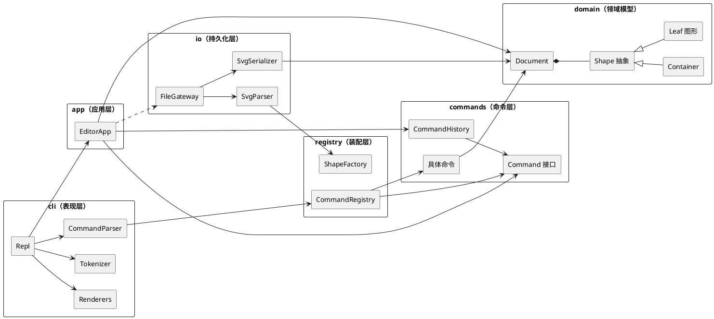
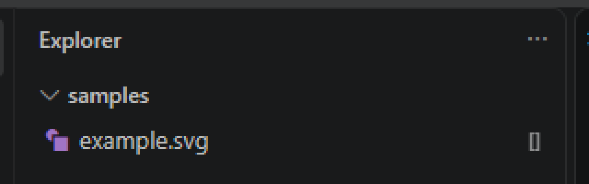
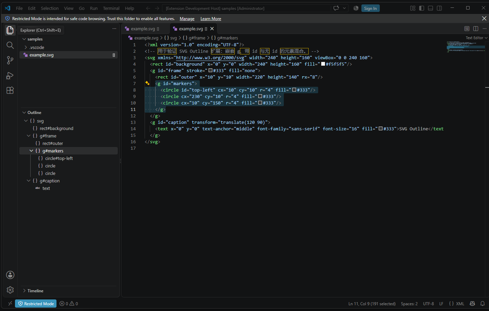
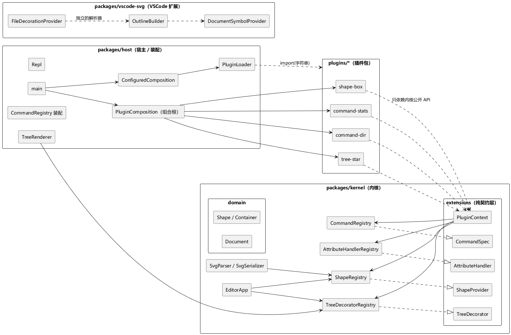

# Lab1 — CLI SVG 编辑器 · 设计文档（Phase 1 + Phase 2）

> 本文档是作业的正式交付物。
> **§1–§4 是 Phase 1**（架构方案、过程记录、一致性自查、质量保证手段），
> **§6–§7 是 Phase 2**（VSCode 插件实践、CLI 插件式重构）。
> 每次实质性变更记入 [§8 修订记录](#8-修订记录)。

| 项 | 值 |
|---|---|
| 代码仓库 | <https://github.com/Qiscars/svg-editor> |
| Phase 1 定稿 | tag **`final`**（`git checkout final` 即拿到阶段一定稿状态） |
| Phase 2 定稿 | tag **`p2`** |
| 实现规模（Phase 1） | 50 个源文件 · 19 条命令 · 175 个测试用例 · 47 次提交 |
| 实现规模（Phase 2） | 4 个包（kernel / host / vscode-svg）+ 5 个插件包 · 21 条命令 · 271 个测试用例 |
| 文档版本 | v2.2（见 §8 修订记录） |

---

## 目录

**Phase 1**

1. [架构方案](#1-架构方案)
2. [过程记录](#2-过程记录)
3. [一致性自查](#3-一致性自查)
4. [质量保证手段](#4-质量保证手段)

**Phase 2**

6. [VSCode 插件实践](#6-phase-2一vscode-插件实践)
7. [CLI 插件式重构](#7-phase-2二cli-插件式重构)

**附录**

8. [修订记录](#8-修订记录)

---

## 1. 架构方案

### 1.1 模块划分

代码按**分层**组织，每层一个目录，层内"一类一文件"（文件名 = 类名）。

```text
svg-editor/
├── doc/                       # 设计文档（本文件）
├── src/
│   ├── main.ts                # 组合根：装配对象、启动 REPL
│   │
│   ├── domain/                # 【L0 领域模型】纯内存数据结构与几何语义，零 I/O
│   │   ├── Shape.ts           #   抽象基类：id、父指针、几何/属性访问器的抽象契约
│   │   ├── Container.ts       #   Composite：容器（对应 <g> 与画布根）
│   │   ├── Canvas.ts          #   画布根容器（宽高 + viewBox）
│   │   ├── Document.ts        #   当前文档：Canvas + id 索引 + 结构不变量
│   │   ├── IdIndex.ts         #   id → Shape 的唯一索引（唯一性/查找）
│   │   ├── ShapeError.ts      #   领域错误（no such shape / id already exists …）
│   │   └── leaf/              #   叶子图形：Rect / Circle / Ellipse / Line / TextShape
│   │
│   ├── commands/              # 【L1 命令层】Command 模式，一次编辑 = 一个对象
│   │   ├── Command.ts         #   接口：execute() / undo() / describe()
│   │   ├── CommandHistory.ts  #   undo / redo 双栈 + "IO 之后禁止 undo" 的闸门
│   │   ├── CommandContext.ts  #   命令可用的上下文（Document + 结果输出端口）
│   │   └── impl/              #   Create / Delete / Move / Scale / Set / Group /
│   │                          #   Ungroup / AddTo / Reorder(front,back)
│   │
│   ├── io/                    # 【L1 持久化层】SVG 文本 ↔ 领域模型
│   │   ├── FileGateway.ts     #   文件读写的唯一出口（错误 → cannot read/write file）
│   │   ├── SvgSerializer.ts   #   Document → SVG 文本
│   │   └── SvgParser.ts       #   SVG 文本 → Document（缺 id 自动补名 + 警告）
│   │
│   ├── registry/              # 【L2 装配层】仅有的两处"按名字分派"
│   │   ├── ShapeFactory.ts    #   图形类型名 → 构造函数（分派点 ①）
│   │   └── CommandRegistry.ts #   命令名 → 命令构造器 + 用法文本（分派点 ②）
│   │
│   ├── app/                   # 【L2 应用层】用例编排
│   │   └── EditorApp.ts       #   持有 Document / History，把结构化调用变成命令执行
│   │
│   └── cli/                   # 【L3 表现层】REPL、分词、渲染
│       ├── Repl.ts            #   读行循环、提示符、注释与空行
│       ├── Tokenizer.ts       #   处理双引号参数、`#` 注释
│       ├── CommandParser.ts   #   文本 → 结构化调用（token 序列 → 参数对象）
│       ├── ConsoleOutput.ts   #   输出端口的唯一实现
│       └── render/            #   TreeRenderer / ShowRenderer / HelpRenderer
│
└── tests/                     # 单元测试 + 场景回放测试
```

> 上面是**方案 v1 的目录设计**。实现期在层内新增了 9 个辅助类、删除了 1 个（`HelpText.ts`），
> 层归属与目录层级零变化。逐条偏差与原因见 [§3.1 一致性自查](#31-模块划分实际目录与方案是否一致)。

**各模块职责**

| 模块 | 职责 | 明确*不*做的事 |
|---|---|---|
| `domain` | 图形树的唯一真相：树结构、id 索引、几何属性、属性的读写与合法性（`set` 白名单） | 不解析文本、不读写文件、不打印、不知道 undo 的存在 |
| `commands` | 把"一次编辑"封装成可执行/可撤销对象；维护 undo/redo 栈 | 不解析命令行文本、不碰文件、不直接 `console.log` |
| `io` | SVG 文本与 `Document` 的双向转换；文件系统访问 | 不实现编辑语义、不做撤销、不决定 CLI 输出格式 |
| `registry` | 名字 → 实现的查表；命令用法文本的单一来源 | 不含业务规则（构造完命令就退出） |
| `app` | 用例编排：接收结构化调用 → 造命令 → 执行 → 组织结果 | 不做分词、不格式化输出 |
| `cli` | 行级 I/O、分词与参数解析、结果渲染（tree/show/help/错误行） | 不直接改图形树（一律经 `app` → `commands`） |

**组件图**


> 上图由同目录的 [component.puml](diagrams/component.puml) 用 PlantUML 渲染而来，
> 箭头方向即编译期 import 方向，与 [§1.3 依赖方向规则](#13-依赖方向规则) 一一对应。
> 源码展开见下方折叠块（想改图改这个文件，再重新渲染即可）。

<details>
<summary>PlantUML 源码</summary>



</details>

### 1.2 设计模式的选择

#### ① Command —— 撤销重做的骨架（作业要求必选）

**问题**：`undo` 必须精确还原上一次编辑，且 `group g1 r1 c1 t1` 这种多目标操作整体算**一个**撤销单元。

**落地方式**：

- 每个编辑类命令实现同一接口 `Command`：

  ```ts
  interface Command {
    execute(): CommandOutcome;   // 正向执行
    undo(): CommandOutcome;      // 精确回滚
    describe(): string;          // 成功摘要，如 `rect#r1 moved to (130,20)`
  }
  ```

- `CommandHistory` 只认这个接口，维护 `undoStack` / `redoStack`：
  `undo()` → 弹栈并调用 `command.undo()`；`redo()` → 弹 redo 栈并重新 `execute()`。
- "一条命令 = 一个单元"是**天然结论**：多目标操作写在同一个命令对象里，只有一对
  `execute/undo`，不会拆成多个栈元素。
- 撤销的反向信息由命令**自己**以 Memento 形式持有（删掉的子树快照 + 父节点 + 下标、
  属性旧值等），而不是对整个文档拍快照——避免 undo 栈随文档规模线性膨胀。
- `undo` 后若有新编辑，`redoStack` 清空（由 `CommandHistory` 单点保证）。

#### ② Composite —— 容器与叶子一视同仁

`Shape` 抽象基类统一 `id / parent / move / scale / setAttribute / delete` 语义；
`Container` 递归转发给子节点，叶子自己实现几何变换。因此
`move node2 0 100`（一个 `<g>`）与 `move c1 30 0`（一个 `<circle>`）在命令层毫无区别，
**命令实现里不出现任何 `if (isContainer)` 分支**。

#### ③ Factory + Registry —— 仅有的两处按名字分派

作业允许的"未模块化"只有两处，本方案把它们**各自压到一行查表**，并登记为待重构项：

- `ShapeFactory`：`type 名 → 构造函数`，供 `create` 与 `SvgParser` 共用；
- `CommandRegistry`：`命令名 → 命令构造器 + 用法文本`，供分发与 `help` 共用。

#### ④ 多态属性表（替代 `switch(tag)`）

`tree`、`show`、`save` 都需要"按图形类型做不同展示"，方案里**不写 `switch(tag)`**：

- 每个类型用 `geometryAttributes()` 声明自己的可写属性，`tree` / `show` / SVG 序列化
  都遍历同一份声明（`Shape.describeInline()` / `describeDetailLines()`）——
  `rect` 显示 `x= y= w= h=`，`circle` 显示 `cx= cy= r=`，由一个实现自然分派；
- `set` 的白名单同样来自这份声明（`settableAttributes()`），未知属性统一报
  `error: unknown attribute: <attr>`；
- 序列化由 `io/SvgSerializer` **数据驱动**：读 `shape.attributes()` 逐条输出，
  不做按类型分支。

> **实现期修订（v1.2）**：本节最初写的是"`Shape.toSvgElement()` 由子类实现"。
> 实现到 #18 时发现它与 §1.3「`domain` 不认识 XML」直接冲突——让子类产出 XML 元素，
> 等于把 XML 概念塞进领域层。改为上面的"属性表 + 数据驱动的序列化器"后，
> 领域层仍然零 XML 知识。差异已记入 §8 修订记录。

#### ⑤ Template Method —— `set` 的统一校验流程

`Shape.setAttribute()` 是模板方法：先在 `settableAttributes()` 声明的白名单里校验，
再交给子类的 `applyAttribute()` 做类型化赋值。校验与报错只有一份实现。

### 1.3 依赖方向规则

分层与允许的依赖：

| 层 | 模块 | 允许依赖 | 禁止依赖 |
|---|---|---|---|
| L0 | `domain` | 仅 TypeScript 标准库 | 任何其他内部模块；`node:fs` 等 I/O 模块 |
| L1 | `commands` | `domain` | `io`、`cli`、`app`、`registry` |
| L1 | `io` | `domain`、`registry` 的 `ShapeFactory` | `commands`、`cli`、`app` |
| L2 | `registry` | `domain`、`commands` | `io`、`cli`、`app` |
| L2 | `app` | `domain`、`commands`、`io`、`registry` | `cli` |
| L3 | `cli` | `app`、`domain`（只读类型与渲染）、`registry`（取用法文本） | `io` 的写操作 |
| L4 | `main.ts` | 所有层（唯一装配点） | — |

**附加规则**

1. **只允许"上层 → 下层"**，禁止同层横向依赖（`io` ⇸ `commands`，`commands` ⇸ `io`）。
2. **`domain` 不认识 XML，也不认识命令行**：它只提供数据结构与几何语义。
3. **`commands` 不碰文件系统**：`save` / `read` 属于文档类命令，由 `app` 编排 `io`，
   并且**不进入 undo 栈**（执行后置"IO 闸门"，使 `undo` 报
   `error: undo not allowed after io command`）。
4. **输出端口唯一**：`commands` / `app` 不直接写 `stdout`，只把结果返回给 `cli` 渲染；
   `io` 的错误转成领域错误向上抛，由 `cli` 统一加 `error:` 前缀。
5. **违反上述任一规则即记为待处理项**，在修订记录中登记并安排修复。

**理由**：把"会变的"（界面、持久化格式、撤销策略）挡在领域之外，使
`domain` 可以在完全没有 I/O 的情况下被单元测试覆盖；同时保证换一个前端（GUI / HTTP /
agent 通道）时，只新增一个 `cli` 层的 adapter，`app` 与 `domain` 零改动。

### 1.4 变化点假设

| # | 变化点 | 判断依据 | 为它留了什么 / 为什么不留 |
|---|---|---|---|
| 1 | **新增图形类型**（`polygon`/`path`，以及后续插件化的 `box`） | 作业 Phase 2–3 明确要求 `box` 由**插件**注册，`create box` 现在必须报 `unknown shape type` | **留了**：`Shape` 抽象 + `ShapeFactory` 注册表。Phase 2 只需让 `ShapeFactory` 变成可变注册表并引入 `ShapeProvider` 接口，`domain`/`commands` 不动。**本阶段不实现插件机制**，因为它尚无第二个消费者，过早抽象会锁死接口形状 |
| 2 | **输出通道变化**（CLI → GUI / HTTP / agent 工具调用） | 作业后续阶段会出现画布与"三种通道" | **留了**：`cli` 与 `app` 之间以**结构化调用对象**（`CommandInvocation`）为界，而不是裸字符串；换通道只需新写 adapter。**不留**的是多前端共存的抽象基类——当前只有 CLI 一个消费者 |
| 3 | **撤销策略变化**（命令逆操作 → 文档快照 / 持久化历史） | 快照法实现简单但内存随文档线性增长；命令逆操作精细但每个命令都要写 `undo` | **留了**：`CommandHistory` 只依赖 `Command` 接口，替换成快照式历史不影响命令实现；命令内部以 Memento 保存旧值，日后换成 `structuredClone` 全量快照只需改 `CommandContext` |
| 4 | **SVG 序列化格式变化**（`transform` 属性 vs 直接改写子坐标、`data-*` 标记、样式属性扩充） | `box` 的 round-trip 需要 `data-kind`，未来还可能引入 `transform` | **留了**：序列化/解析完全隔离在 `io`，`domain` 只存"语义属性"。**刻意不留**的是可插拔的序列化策略——一种格式一个实现实现即可，多态到策略只增加间接层 |
| 5 | **`scale` 的语义变化**（当前按作业要求"位置与尺寸同乘"，未来可能要"绕中心缩放"） | 作业定义了一次性语义，但图形编辑器的直觉是绕中心 | **留了**：缩放集中在 `Shape.scale(factor)` 一个方法，改为绕中心只改这一处 + 容器递归策略 |
| 6 | **寻址方式变化**（id 定位 → 结构路径 `/canvas/g1/rect[2]`） | 作业 §2 明确"结构路径本阶段不要求" | **刻意不留**：id 已是 SVG 规范内的合法寻址手段，且 `IdIndex` 是单点。留一层路径解析器会立刻产生"两套寻址并存"的一致性问题，得不偿失 |
| 7 | **性能：超大文档**（10k 节点） | 目前所有操作都是 O(n) 递归 | **刻意不留**：作业规模在百级节点，过早引入脏标记/增量索引会让代码复杂度上升而收益为零 |

### 1.5 已知待重构项

| # | 位置 | 现状 | 计划 |
|---|---|---|---|
| R1 | `registry/ShapeFactory.ts` | `type 名 → 构造函数` 的 `switch`/查表 | Phase 2 改为可注册的 `Map` + `ShapeProvider` 插槽 |
| R2 | `registry/CommandRegistry.ts` | `命令名 → 命令构造器` 的查表 | 同上；若命令数量增长，改为 `CommandParser` 负责语法、registry 只负责构造 |
| R3 | `cli/HelpText.ts` | 帮助文本暂时是静态常量 | 由 `CommandRegistry` 汇总各命令声明的用法生成（见 `HelpText.ts` 注释） |

---

## 2. 过程记录

记录关键、有代表性的讨论与迭代：AI 给了什么建议、发现了什么问题、如何确认并纠正。

> 本节是**经过整理的结论**，按阶段成文；未整理的原始流水（每天做了什么、推到哪个提交、还剩多少时间）
> 另记在 [`doc/PLAN.md`](PLAN.md) 的会话日志里。

### 2.1 阶段 0：仓库搭建

- **讨论点：先把仓库立起来，还是先写代码？**
  取舍：作业要求"提交历史须能体现开发过程，禁止 one-shot 大提交"。先把**工程骨架 +
  架构方案**单独提交，后续每个能力一次提交，历史本身就是开发过程的证据。
  因此本阶段的提交顺序被刻意设计为
  `仓库配置 → 工具链 → 架构方案文档 → REPL 骨架`，且第一条提交里没有任何业务逻辑。
- **讨论点：构建产物要不要入库？**
  决定：不入库（`.gitignore` 忽略 `dist/`、`node_modules/`），工程用 `npm run cli`
  一条命令完成"编译 + 启动"，保证 clone 下来即可复现。
- 实现阶段的讨论记录见 [§2.2](#22-阶段-1领域模型与命令层1021)（领域模型与命令层）、
  [§2.3](#23-阶段-2持久化与-cli1022)（持久化与 CLI）、[§2.5](#25-阶段-3质量保证与收尾1023)（质量保证与收尾）。

### 2.2 阶段 1：领域模型与命令层（10/21）

本节记录的都是**真的发生过**的问题：AI 先给方案 → 写下去撞墙 → 确认原因 → 改。

#### ① 撤销用属性快照，而不是"反向操作"

最初的想法很自然：`move` 的逆是 `move(-dx, -dy)`，`scale(f)` 的逆是 `scale(1/f)`。
动手写测试时立刻遇到两个反例：

- `0.1 + 0.2 - 0.2 !== 0.1`（浮点加减不保值）；
- `scale(3)` 之后 `scale(1/3)` 回不到原坐标。

改成 `ShapeSnapshot`：记录受影响子树每个属性的**字符串原值**，恢复时逐字写回。
用例 `scale(3) 撤销后回到精确原值，而不是 99.99999` 钉住了这条。

同时**否决了"整文档快照"**这个更省事的选择：撤销栈每层存整棵树，深度一上去内存就爆。
因为 `move` / `scale` 不改结构，只记受影响子树的属性就已经完备。

#### ② `Document.attach` 在"移动归属"路径上误报 id 冲突

`group` / `addto` 需要把**已登记**的图形换一个父容器。第一版 `attach` 无条件调用
`registerTree`，于是 `doc.attach(markers, c1)` 直接抛 `id already exists: c1`。

修正为区分两种情况：首次挂载才登记子树，"移动归属"只改父指针。
这个问题是跑冒烟脚本撞出来的，不是读代码看出来的——说明只靠类型检查和单元测试还不够，
得有端到端跑一遍的习惯。

#### ③ 测试推翻了实现假设，也推翻了我的测试假设

我原以为 `set c1 r abc` 应该在**构造命令时**就报错，于是断言写成了构造期抛错。
实际是在 `execute()` 期抛的。第一反应是"实现错了"，核对后确认这是对的：

- 属性值是否合法，只有 `AttributeSpec.write` 有资格判断，命令层重复实现解析会立刻出现两份真相；
- 安全性由 `CommandHistory.run` 的结构保证——`execute()` 抛错就不入栈、也不会有半成品状态。

于是改的是**测试**而不是实现，断言变成「`run` 抛错 + 撤销栈深度仍为 0 + 状态未变」。
这比原来的断言更准确地验证了那条不变量。

#### ④ 错误语义的自我纠正

`Container.insertChild` 拒绝自环时抛的是 `invalid id: cannot add g#g1 into itself`，
模板套错了（`invalid id` 是给非法 id 用的）。新增 `ShapeError.cannotInsertIntoSelf`，
消息改为 `cannot insert a container into itself: g1`。

### 2.3 阶段 2：持久化与 CLI（10/22）

#### ① 方案与依赖规则打架：`toSvgElement`

原架构方案 §1.2 ④ 写的是"`Shape.toSvgElement()` 由子类实现，序列化不集中在一处大 `switch`"。
写到 io 层时发现它和 §1.3 的「`domain` 不认识 XML」**直接冲突**——让领域对象产出 XML 元素，
等于把 XML 概念塞进领域层。三个可选方案：

| 方案 | 问题 |
|---|---|
| A. 保持原方案，在 `domain` 里定义 `SvgElement` 模型 | `domain` 依赖 XML 概念，违反 §1.3 |
| B. 序列化器里写 `switch (shape.kind)` | 正好踩中作业禁止的"到处 `switch(tag)`" |
| C. 各类型声明属性表，序列化器数据驱动遍历 | 无分支，`domain` 仍零 XML 知识 |

选 C。改动不大，但它**同时改了三处**：§1.2 正文、§8 修订记录 v1.2、`doc/PLAN.md §5.1` 的待办状态。
这正是"一致性自查"要的东西：方案偏离就留痕，而不是事后当没发生过。

#### ② `tree` 的属性列宽：作业给的两个示例互相矛盾

用**同一套算法**推不出两个示例：§5.1 例 1 的属性列在第 19 列，§6.1 的例子在第 29 列。

实现取"**列宽 = 最宽（前缀 + id）+ 2，且至少 1 个空格**"。实测结果：

- §5.1 例 1 —— **逐字一致**；
- §6 transcript 里 `read other.svg` 之后的树 —— **逐字一致**（也是 19 列）；
- §6.1 流程图 —— 内容完全一致，但整体宽 3 列。

三个示例里两个逐字复现，第三个是格式差异而非语义差异，故按格式差异处理并把取舍写在这里。
（另外 §6 的树里 `ellipse#e1 … y=2` 是笔误：SVG 椭圆没有 `y`，实际属性是 `cy`，
本实现输出 `cy=2`。）

#### ③ 待重构项 R3 是"顺手"消除的

`help` 最初是一份静态常量 `src/cli/HelpText.ts`，加一条命令要改两处（实现 + 帮助文本），
在方案里被登记为待重构项 R3。做成 `CommandRegistry` 后，命令的 `usage` / `summary` 就写在
命令自己的声明里，`help` 直接汇总——**加一条命令只改一个地方**。
`tests/cli/CommandRegistry.test.ts` 里有一个用例专门验证这点："注册一条新命令后 help 自动包含它"。

#### ④ 我算错了命令条数

计划里一直写"命令覆盖 23/23"。真正逐行数作业 §3 的命令总表：共 17 行，
其中 `front / back` 与 `undo / redo` 各占一行但含两条命令，合计 **19 条**。
已在总览、Day 3 验收标准、`PLAN.md §5.1` 三处修正。教训：验收标准要拿总表逐行数，不能凭印象估。

#### ⑤ 一次与代码无关的阻塞

10/22 下午本机代理未运行，直连 `github.com:443` 能建立 TCP 但 TLS 被重置
（`Recv failure: Connection was reset`，换成 Schannel 后端也无效），导致 5 个提交滞留在本地。
处理方式是把阻塞**写进 `PLAN.md §5.2`**（含现象、影响、恢复条件），而不是让看板显示"一切正常"；
代理恢复后一次 `git push` 解决，再把该节改为"已解除"。

### 2.4 Day 2 端到端验收结果

| # | 验收项 | 结果 | 证据与说明 |
|---|---|---|---|
| 1 | 作业 §6 会话回放与 transcript 逐行一致 | ✅ 通过 | 场景脚本 `doc/scenarios/basic-session.txt`，回放输出见 `basic-session.golden.txt`（69 行）。`canvas 800x600 created`、`saved to demo.svg (5 elements)`、`error: undo not allowed after io command`、`warning: assigned id rect1 to unnamed <rect>`、`read other.svg (7 elements)` 全部逐字一致；仅 §6 原文的 `ellipse … y=2` 按 SVG 规范输出为 `cy=2`（原文笔误） |
| 2 | 作业 §6.1 两节点流程图 | ✅ 通过 | `doc/scenarios/flowchart-session.txt`；8 个元素、层级与作业一致；`move node2 0 100` 后 `g#node2 moved by (0,100)`、`undo` 后 `moved back by (0,-100)`；树的内容一致，属性列宽差 3 列（格式差异，见 §2.3 ②） |
| 3 | `save` 出的 SVG 在浏览器正确渲染 | ✅ 通过 | 用无头 Edge 打开 `demo.svg` 与 `flowchart.svg` 截图：`doc/images/demo-render.png`、`doc/images/flowchart-render.png`。可见白底、红色圆（已移动到 130,100）、蓝色方块、文字，以及流程图的连线与中文标题 |
| 4 | 文档类命令后 `undo` 被拒 | ✅ 通过 | `save demo.svg` 之后 `undo` 输出 `error: undo not allowed after io command`；`init` / `read` 走 `CommandHistory.reset()`（连栈一起作废），`save` / `canvas` 走 `markIoBoundary()`（栈保留、只上闸门） |

### 2.5 阶段 3：质量保证与收尾（10/23）

#### ① 依赖检查第一次运行就把我判了：12 处违规

Day 3 的第一件事是给 §1.3 的规则写一个可执行检查。写完后第一次运行：

```text
依赖方向检查失败：12 处违规（app:1 cli:12 commands:15 domain:13 io:5 entry:1 registry:2）
```

全部是 `cli → commands`。原因很朴素：Handler 为了 `new XxxCommand(...)` 直接 import 了
9 个命令类，`Tokenizer` 为了抛语法错误引用了 `CommandError`。

这里的判断很关键：**是我实现时偷懒了，还是规则定错了？**

- 方案 §1.1 写的是"app：接收结构化调用 → **造命令** → 执行"；
- 方案 §1.3 的 cli 允许依赖表里没有 `commands`。

两条都指向同一结论：**代码错了，规则没错**。所以选择改代码而不是改规则。

修复用了三个候选方案里最"疼"的一个：

| 方案 | 代价 | 取舍 |
|---|---|---|
| A. 放宽 §1.3，允许 cli → commands | 改两行文档 | ✗ 等于承认"分层只是写着好看" |
| B. 让 registry 帮 cli 造命令 | 注册表要认识所有命令参数 | ✗ 把分派点变成业务层 |
| C. 把命令构造下沉到 `EditorApp` | 应用层多 9 个方法，cli 层要重写 | ✓ 与 §1.1 的原意一致 |

选 C。改完 `check-layers` 退出码 0。**这件事本身就是 §1.3 那句"违反规则的依赖即为待处理项"的意义**：
如果没有脚本，这 12 处会一直躺在那里，而我在写一致性自查时会理直气壮地写"经检查无违反"。

#### ② 又一个测试假设被推翻：XML 转义规则

写 io 测试时我断言"文本里的 `"` 也会转义成 `&quot;`"，测试红了。查下来是**测试错了**：

| 位置 | `<` | `&` | `"` |
|---|---|---|---|
| 元素**内容** | 必须转义 | 必须转义 | **无需转义**（合法字符） |
| 属性**值** | 必须转义 | 必须转义 | 必须转义 |

改成两个用例分别钉住两种情况。这和 §2.2 ③ 是同一类经验：**测试先去验证"我以为的规则"，
发现规则本身理解错了，改的应该是测试而不是实现**。但前提是能分清这两种情况——
判据是去查规范/实现，而不是"哪个改起来更省事"。

#### ③ 有一条错误我根本无法覆盖

作业 §4.2 的 `cannot ungroup composite shape` 是给插件阶段的 `box` 用的。本阶段没有插件，
这条错误永远不会被触发。

处理方式：**不写假装通过的用例**。改成验证"普通非顶层 `g` 必须能解散"，
并在 `§4.3` 明确标注 `⚠️ 本阶段 N/A`，覆盖率写成 **11 / 11 可触发项**而不是含糊的 12/12。

把"没实现"混进"覆盖率 100%"是最容易糊弄也最没价值的做法——评审只要问一句
"这条错误在哪触发"就穿帮了。

#### ④ 计划外多了一个提交

原计划 32 个提交，实际 33 个：`#26a` 是重构，不在计划里。

处理方式：在看板 `§2` 里加一行标注「**追加**」，写明原因（检查器抓到违规必须改），
而不是悄悄改编号或压进别的提交。计划可以变，但变化要留痕——这是 `doc/PLAN.md §5.1` 的用意。

---

### 2.6 阶段 4：Phase 2 的插件式重构（10/24–10/26）

这一阶段的工作量比 Phase 1 大，且**几乎每一步都是先被工具或测试打回来，再修正**。
以下是真实发生过的、值得记录的几处。

#### ① 层次检查器抓出循环依赖，我改的是架构不是规则

把内置实现搬进 `packages/kernel` 之后，`tools/check-layers.mjs` 一次报出 6 处违规：

```text
commands/CommandContext.ts      commands 层不允许依赖 extensions 层
commands/impl/SetAttributeCommand.ts  同上
extensions/PluginContext.ts     extensions 层不允许依赖 app 层
io/SvgParser.ts                 io 层不允许依赖 extensions 层
io/SvgSerializer.ts             同上
```

最省事的做法是把 `extensions` 加进每一层的白名单里——**但那等于把检查器废掉**。
真正的问题是两件事：

1. `extensions` 里混了两种东西：**契约**（四个接口）与**实现**（注册表），后者要报"命令名未知"
   这类错误，于是去依赖 `commands/CommandError`；
2. `PluginContext` 直接引用了 `EditorApp`，形成 `extensions ↔ app` 循环。

处理：把注册表用的错误抽成 `extensions/RegistryError`（只依赖 `domain`），
把 `PluginContext` / `SvgFramePlugin` 泛型化成 `PluginContext<TContext>`。
规则没放宽一行，依赖方向反而更干净了：`extensions` 现在只依赖 `domain`。

**教训**：检查器报错时，先问"是我的规则太严，还是我的设计真的错了"。
默认答案是后者——规则是你自己定的，放宽它等于自欺。

#### ② 加载器的两个真缺陷是测试逼出来的

写 `tests/plugins/loader.test.ts` 时，两条用例直接失败：

- 插件模块**内部** import 了一个不存在的依赖，加载器报 `plugin not found` —— 这违反了
  作业"模块存在但求值失败不属顶层模块找不到"的要求；
- 插件注册了重名扩展，加载器报 `plugin failed to activate: dup (duplicate registration: …)` ——
  而作业 §6 的格式表要求这一行是 `error: duplicate registration: <category>/<name>`。

两处都不是"测试写错了"，而是实现确实不合规。修法分别是：

- 先**独立确认顶层模块可解析**（相对路径 `existsSync`，包名 `import.meta.resolve`），
  之后的 `import()` 失败一律归"加载失败"；
- `activatePlugin` 的 catch 里单独识别 `RegistryError` 且消息以 `duplicate registration:` 开头的情况，
  原样输出，不再包裹。

**教训**：失败路径的文案是**接口的一部分**。写测试时逐字比对文案，比"能跑通"有用得多。

#### ③ 差点被 banner 破坏的"逐字节一致"

拆分完成后我把 `BANNER` 从 `svg-editor 0.1` 改成了 `0.2`，觉得"版本号本来就该涨"。
随后基线回归失败——因为**回放比对的是整段输出，包括 banner**。

改回 `0.1`。并在 `tools/verify-assembly.mjs` 里把"基线回归"做成常驻检查，
而不是靠人记得去 diff。

**教训**："逐字节一致"是个只有 0 和 1 的判据。任何一处自以为无害的美化都会让它变成 0。
觉得某处改动"应该没关系"的时候，正是需要一条自动检查的时候。

#### ④ 复合图形让 `Document` 的一个隐藏假设暴露了

`box` 是一条命令里同时插入根 + 两个子部件。原来的 `registerTree` 是递归登记，
子部件 id 冲突时会**留下一半已登记的索引**。

改成两遍：先把整棵子树的 id 全部校验一遍，再统一写入索引。
这样"整条命令失败、不留下容器或子部件"才是真的成立。

**教训**：Phase 1 里一个命令只插一个节点，所以"先校验后写入"与"边校验边写入"没有区别；
新需求（复合图形）把这个区别放大成了 bug。这类"被新需求点亮的旧假设"，
比显式 TODO 更值得记下来。

#### ⑤ 工具链上的两个坑（PowerShell）

- `Set-Content -Encoding UTF8` 在 Windows PowerShell 5.1 下会写 **BOM**，
  而 TypeScript 与 `git diff` 都会把它当内容的一部分。改用
  `[System.IO.File]::WriteAllText(path, text, UTF8Encoding($false))`。
- `git commit -m "...中文引号..."` 里的引号会被 PowerShell 吃掉，
  导致提交信息缺字。改成**写文件 + `git commit -F`**。Phase 1 就踩过，这阶段固定成了习惯。

**教训**：这类"环境坑"不值得写进架构，但值得写进流程——因为它会重复发生。

#### ⑥ 截图最终拍成了，而且它抓出一个单测抓不到的 bug

交付过程中本机一直没装 VSCode，所以当时的做法是：把扩展做成"纯逻辑 + 薄适配层"，
用 vitest 覆盖纯逻辑（`tests/vscode/`），并把运行步骤写进 `packages/vscode-svg/README.md`，
在 §7.7 里把"补截图"显式列为待补项——**不伪造截图，也不写"已验证"**，
这是 Phase 1 §2.5 ③ 就定下的规矩。

后来装上 VSCode 实跑，第一次打开就暴露了一个**单测完全覆盖不到**的真 bug：

- 徽标正常显示（`[]` 出来了），但 Outline 面板是空的，提示 `No symbols found in document`；
- 根因：VSCode 内置把 `.svg` 关联到 **`xml`** 语言，并不存在内置的 `svg` 语言 id。
  而我把 provider 注册成了 `{ language: 'svg' }` —— 它**永远不会被调用**。
- 也就是说：`OutlineBuilder` 的 19 个用例、`fileBadge` 的 17 个用例全绿，
  解析逻辑一个字都没错，错的是**适配层的注册条件**。

修法：选择器改为 `[{ language: 'svg' }, { pattern: '**/*.svg' }, { pattern: '**/*.SVG' }]`，
以路径为主判据；编辑刷新事件原本也用 `languageId === 'svg'` 判断（同一个坑的第二个落点），
一并改成纯函数 `isSvgDocument(languageId, path)`，并补了 4 个用例把它钉住。

**教训**：单元测试覆盖的是"纯逻辑对不对"，覆盖不了"**这段代码到底会不会被调用**"。
边界层的注册条件、事件过滤条件、文档选择器这类"接线"，只有真的跑起来才知道。
这也说明"纯逻辑 + 薄适配层"的分层是对的——修 bug 时只动了 3 行适配代码，
解析器一行没碰，改完重跑测试仍然全绿。

---

## 3. 一致性自查

> 本节对照方案**如实回答**，不是复述方案。检查方法尽量做成可重跑的命令，结论附实测输出。

### 3.1 模块划分：实际目录与方案是否一致？

**检查方法**：`git ls-files src` 取实际清单，与 §1.1 的目录树逐条对照。

**实际规模**：50 个源文件 —— `domain` 13、`commands` 15、`io` 5、`registry` 2、`app` 1、`cli` 13、入口 1。

**一致的部分**（§1.1 列出的路径全部存在，职责未变）：

```text
src/main.ts
src/domain/{Shape, Container, Canvas, Document, IdIndex, ShapeError}.ts   + leaf/×5
src/commands/{Command, CommandContext, CommandHistory}.ts                 + impl/×9
src/io/{FileGateway, SvgParser, SvgSerializer}.ts
src/registry/{ShapeFactory, CommandRegistry}.ts
src/app/EditorApp.ts
src/cli/{Repl, Tokenizer, CommandParser, ConsoleOutput}.ts               + render/×2
```

**偏差 10 项**（全部已登记到 §8 修订记录 v1.4）：

| 文件 | 类型 | 引入于 | 方案里为什么没有 |
|---|---|---|---|
| `domain/Numbers.ts` | 新增 | #6 | 数值解析与格式化需要被 `set`、`tree`、序列化共用；写方案时没意识到会有三处共用同一套格式 |
| `domain/EditorError.ts` | 新增 | #24 | 统一错误基类，是"两个错误子类各管一段、表现层要分别 catch"这个问题的收口 |
| `commands/DocumentCommand.ts` | 新增 | #12 | 命令基类，省掉 9 条命令重复写 `context` 字段与构造函数 |
| `commands/CommandError.ts` | 新增 | #11 | 与 `ShapeError` 分工：一个说"图形树不成立"，一个说"这个操作现在不能做" |
| `commands/ShapeSnapshot.ts` | 新增 | #13 | 方案写的是"命令自己持有 Memento"；实现时抽成独立类，因为 move 与 scale 共用同一套快照逻辑 |
| `io/xml/{XmlElement, XmlParser}.ts` | 新增 | #19 | 自研 XML 子集解析器。方案假设"解析 SVG"是件小事，实际要处理声明、注释、自闭合、属性和实体 |
| `cli/CliError.ts` | 新增 | #26a | 语法类错误（引号、参数个数）归表现层，是被 §3.2 的检查逼出来的 |
| `cli/handlers/×5` | 新增 | #22 | 命令表的具体条目。方案只写到 `CommandRegistry` 这一层，没细化到"每条命令一个声明放哪" |
| `cli/DefaultCommandRegistry.ts` | 新增 | #22 | 唯一装配点（全项目仅此处知道"一共有哪些命令"） |
| `cli/HelpText.ts` | **删除** | #22 | 待重构项 R3：静态帮助常量被注册表生成的文本取代 |

**结论**：**层归属零变化**——偏差全部是"层内新增辅助类"，没有任何文件跨层搬家，也没有新的目录层级。
唯一的删除是方案自己列为待重构项 R3 的 `HelpText.ts`，属于按计划还债。

### 3.2 依赖方向：方案里的规则有没有被违反？

**检查方法**：不靠抽样肉眼看，做成可执行检查。

```text
node tools/check-layers.mjs
```

它扫描 `src/**/*.ts` 的全部静态 `import` / `export … from`，按 §1.3 的矩阵逐条断言，
额外检查 `domain` 不得出现 `node:*`。违规即退出码 1。

#### 第一次运行：失败，12 处违规

```text
依赖方向检查失败：12 处违规（app:1  cli:12  commands:15  domain:13  io:5  entry:1  registry:2）
  src/cli/handlers/EditCommandHandlers.ts:3   cli 不允许依赖 commands
      ../../commands/impl/AddToCommand.js
  src/cli/handlers/EditCommandHandlers.ts:4   cli 不允许依赖 commands
      ../../commands/impl/CreateShapeCommand.js
  …（另 8 条同类：10 个命令类 + CommandError）
  src/cli/Tokenizer.ts:1                      cli 不允许依赖 commands
      ../commands/CommandError.js
```

完整清单存档在 [`doc/quality/check-layers-before.txt`](quality/check-layers-before.txt)。

**根因**：Handler 为了 `new XxxCommand(...)` 直接 import 了 9 个命令类；`Tokenizer` 为了抛
`unclosed double quote` 引用了 `CommandError`。而 §1.1 明确写着"app 负责造命令"，
§1.3 的 cli 允许依赖表里也没有 `commands`——**是实现的错，不是规则的错**。

**修复**（追加提交 `#26a`，详见 §2.3）：

- 命令构造下沉到 `EditorApp` 的 9 个编辑方法，表现层只表达意图；
- 语法类错误改由新增的 `cli/CliError` 承担（它的判据完全来自命令行文本，归表现层更准确）。

#### 修复后的输出

```text
依赖方向检查通过（app:1  cli:13  commands:15  domain:13  io:5  entry:1  registry:2）
```

退出码 0，已纳入 `npm run verify` 与每个提交的门禁。

#### 抽样核对（脚本之外的旁证）

`domain` 层 27 条 `import` 全部指向 domain 内部（`./` 或 `../`），`node:` 出现 **0 次**：

```text
Canvas.ts: ./Container.js          Document.ts: ./IdIndex.js        Rect.ts: ../Shape.js
Circle.ts: ../Numbers.js           IdIndex.ts:  ./Shape.js          Shape.ts: ./Numbers.js
Container.ts: ./Shape.js           Numbers.ts:  ./ShapeError.js     …
（共 27 条，无一条跨层）
```

**结论**：**规则最终没有被违反**，但违规真实发生过 12 次——是这条可执行检查把它们拦住的，
不是自觉。这也解释了 §1.3 那句"违反规则的依赖即为待处理项"为什么要配一个脚本。

---

## 4. 质量保证手段

### 4.1 门禁与实测结果

每个提交前都跑同一组命令，四条全绿才允许提交：

```text
node_modules/.bin/tsc -p tsconfig.json          # 编译
node_modules/.bin/tsc -p tsconfig.test.json     # 类型检查（含 tests/）
node_modules/.bin/vitest run                    # 单元 + 集成 + 场景测试
node tools/check-layers.mjs                     # 架构约束
```

（等价的单条命令：`npm run verify`。）

定稿时的实测值：

| 项 | 结果 |
|---|---|
| 类型检查 | 0 错误（`strict` + `noUncheckedIndexedAccess` + `noImplicitOverride` + `verbatimModuleSyntax`） |
| 测试文件 | 13 个 |
| 测试用例 | **175 个，全部通过** |
| 架构约束 | `check-layers` 退出码 0（违规 0 处） |
| 场景对拍 | 作业 §6 会话 69 行输出与 golden 文件逐字相等 |

用例分布：

| 层 / 主题 | 文件 | 用例数 |
|---|---|---|
| 领域模型 | `tests/domain/{transform,attributes,document}.test.ts` | 12 + 21 + 16 = 49 |
| 命令与撤销 | `tests/commands/{CommandHistory,editCommands,errorPaths}.test.ts` | 11 + 31 + 18 = 60 |
| CLI | `tests/cli/{Tokenizer,CommandRegistry,render,Repl}.test.ts` | 13 + 8 + 8 + 7 = 36 |
| 应用层 | `tests/app/EditorApp.test.ts` | 8 |
| 持久化 | `tests/io/roundtrip.test.ts` | 17 |
| 场景回放 | `tests/scenarios/replay.test.ts` | 5 |

下面几节说明这些手段各自要挡住什么。

| 手段 | 具体做法 | 期望证据 |
|---|---|---|
| 类型检查 | `tsc --noEmit`（`strict`、`noUncheckedIndexedAccess`、`noImplicitOverride`） | CI 式脚本 `npm run typecheck` 零错误 |
| 领域单元测试 | `domain` 无 I/O，可对 Composite 语义（move/scale 递归）、id 唯一性、set 白名单直接断言 | `tests/domain/*` |
| 命令测试 | 每个命令的 `execute` → `undo` 后**结构深比较**回到执行前状态 | `tests/commands/editCommands.test.ts` |
| 场景回放（对拍） | 把作业 §6 的 transcript 存成脚本，回放后逐行比对 golden 文件 | `tests/scenarios/replay.test.ts` |
| Round-trip | `save` → `read` → 结构深比较，并断言序列化幂等 | `tests/io/roundtrip.test.ts` |
| 错误路径 | §4.2 每一行错误信息都有一个用例，断言"失败不改状态" | `tests/commands/errorPaths.test.ts` |
| 架构约束 | 依赖方向矩阵做成可执行检查，违规即退出码 1 | `tools/check-layers.mjs` |
| 手工验收 | 用浏览器（无头 Edge）打开 `save` 出的 SVG 截图目视核对 | `doc/images/*.png` |

### 4.2 命令覆盖矩阵（作业 §3 命令总表，共 19 条）

判定口径：**正常路径**要有成功用例，**错误路径**要有失败用例且断言状态不变，
**undo 还原**要验证执行后撤销能回到原状（文档类与显示类命令本就不进撤销栈，标 `—` 并注明原因）。

| # | 命令 | 正常路径 | 错误路径 | undo 还原 |
|---|---|---|---|---|
| 1 | `init [w] [h]` | `tests/app/EditorApp.test.ts`、`tests/scenarios/replay.test.ts` | `errorPaths` 第 11 条（未 init 时报 no document） | — 文档类，换文档后历史作废 |
| 2 | `read <file.svg>` | `tests/app/EditorApp.test.ts`、`tests/io/roundtrip.test.ts` | `errorPaths` 第 10a 条（文件不存在） | — 文档类 |
| 3 | `save [file.svg]` | `tests/app/EditorApp.test.ts`、`tests/scenarios/replay.test.ts` | `errorPaths` 第 10b 条（不可写） | — 文档类，只上闸门 |
| 4 | `canvas [w] [h]` | `tests/app/EditorApp.test.ts`（显示尺寸 / 改尺寸 / 坐标不随画布变化） | `errorPaths` 第 11 条 + 参数个数 | — 文档类，只上闸门 |
| 5 | `create <type> <id> …` | `editCommands` › create | `errorPaths` 第 1 / 3 / 4 / 5 条 | ✅ 深比较 |
| 6 | `delete <id>` | `editCommands` › delete | `errorPaths` 第 2 条 | ✅ 深比较（含整棵子树） |
| 7 | `move <id> <dx> <dy>` | `editCommands` › move | `errorPaths` 第 2 条 + 参数个数 | ✅ 深比较（含小数） |
| 8 | `scale <id> <factor>` | `editCommands` › scale | `errorPaths` 第 9 条 | ✅ 深比较（`scale(3)` 精确回退） |
| 9 | `set <id> <attr> <value>` | `editCommands` › set | `errorPaths` › 白名单外 / 非法值 | ✅ 深比较（含"原本没有的属性去掉了"） |
| 10 | `group <newGid> <id1> …` | `editCommands` › group | `errorPaths` 第 7 条 + id 冲突 | ✅ 一次撤销还原全部 |
| 11 | `ungroup <gid>` | `editCommands` › ungroup | `errorPaths` 第 6 / 8 条 | ✅ 深比较 |
| 12 | `addto <gid> <id>` | `editCommands` › addto | `errorPaths` 第 7 条（成环） | ✅ 深比较（回原父容器原位） |
| 13 | `front <id>` | `editCommands` › front | `errorPaths` 第 2 条 | ✅ 回到原下标 |
| 14 | `back <id>` | `editCommands` › back | `errorPaths` 第 2 条 | ✅ 回到原下标 |
| 15 | `tree [id]` | `tests/cli/render.test.ts`、`tests/scenarios/replay.test.ts` | `render` 不存在的 id | — 显示类 |
| 16 | `show <id>` | `tests/cli/render.test.ts` | 不存在的 id | — 显示类 |
| 17 | `help` | `tests/cli/CommandRegistry.test.ts` | — | — 显示类 |
| 18 | `undo` | `editCommands` › undo/redo 交互、`tests/commands/CommandHistory.test.ts` | `errorPaths`（空栈、IO 闸门） | — 它本身就是撤销 |
| 19 | `redo` | 同上 | `errorPaths`（空栈、IO 闸门） | — |

**覆盖率：19 / 19。** 唯一没有对应错误用例的是 `help`——它没有可失败的输入路径。

### 4.3 错误信息覆盖（作业 §4.2，共 12 行）

| # | 场景 | 用例 | 状态 |
|---|---|---|---|
| 1 | id 已存在 | `errorPaths` › 1 | ✅ |
| 2 | id 不存在 | `errorPaths` › 2 | ✅ |
| 3 | `in` 目标不存在 | `errorPaths` › 3 | ✅ |
| 4 | `in` 目标不是容器 | `errorPaths` › 4 | ✅ |
| 5 | 未注册的图形类型 | `errorPaths` › 5 | ✅ |
| 6 | ungroup 复合图形 | `errorPaths` › 6 | ⚠️ 本阶段 N/A（`box` 属插件阶段，该错误无法触发）；用例改为验证"普通非顶层 `g` 必须能解散" |
| 7 | group 含容器与其子孙 | `errorPaths` › 7 | ✅ |
| 8 | ungroup 根级容器 | `errorPaths` › 8 | ✅ |
| 9 | scale 非正数 | `errorPaths` › 9 | ✅ |
| 10 | 文件不存在 / 不可写 | `errorPaths` › 10a / 10b | ✅ |
| 11 | 未 read/init | `errorPaths` › 11 | ✅ |
| 12 | `undo not allowed after io command`（§4.3） | `errorPaths` › 闸门用例 | ✅ |

**覆盖率：11 / 11 可触发项**（第 6 条按阶段边界不计）。

每条错误用例都同时断言两件事：**报出规定文案** + **整棵树深比较不变、撤销栈深度不变**。
只断言文案是不够的——实现里"先改一半再抛错"也能让文案通过。

---

---

## 6. Phase 2（一）：VSCode 插件实践

> 本节与 §7 一起构成 Phase 2 的交付说明。Phase 1 的架构方案（§1）仍然有效，
> Phase 2 在它之上追加了扩展机制，见 §7。

### 6.1 两个功能

| 功能 | 效果 | 实现要点 |
|---|---|---|
| **A.1 SVG 文件标记** | Explorer 里 `.svg` 文件右侧显示 `[]` 徽标；非 SVG 文件与目录没有；文件名与内容不变 | `FileDecorationProvider` 返回 `badge: '[]'`；判定只看扩展名，大小写不敏感 |
| **A.2 SVG 大纲** | 原生 Outline 里展示元素的嵌套层级；有 id 显示 `标签名#id`，无 id 只显示标签名；点击节点跳到对应源码；编辑后自动更新 | 自己写的容错 XML 扫描器算出每个元素的 `range`，翻译成 `DocumentSymbol`；解析失败就返回空大纲 |

源码位置：

```text
packages/vscode-svg/
├── src/OutlineBuilder.ts     # 纯逻辑：SVG 文本 → OutlineNode[]（不 import 'vscode'）
├── src/fileBadge.ts          # 纯逻辑：路径 → 是否 SVG（不 import 'vscode'）
├── src/extension.ts          # 唯一 import 'vscode' 的适配层
└── samples/example.svg       # 演示用示例（含嵌套 g、有 id 与无 id 元素）
```

**为什么把纯逻辑单独拿出来**：`OutlineBuilder` 与 `fileBadge` 输入输出都是普通数据，
因此可以在 Node/vitest 里直接测（见 `tests/vscode/`），不需要启动 VSCode 实例。
`extension.ts` 只是"把 `OutlineNode[]` 翻译成 `DocumentSymbol[]`"的适配层。

#### 6.1.1 可复现的行为证据

因为本机没有 VSCode，无法拍运行截图，所以把**纯逻辑层的真实输出**贴在这里——
它正是 `FileDecorationProvider` / `DocumentSymbolProvider` 会拿到的数据，
可以直接用 `node --input-type=module -e ...` 重跑：

对 `packages/vscode-svg/samples/example.svg`（含嵌套 `g`、有 id 与无 id 混排、注释、自闭合标签）：

```text
svg   @3:1
  rect#background   @4:3
  g#frame   @5:3
    rect#outer   @6:5
    g#markers   @7:5
      circle#top-left   @8:7
      circle   @9:7
      circle   @10:7
  g#caption   @13:3
    text   @14:5
```

（`@行:列` 是 1-based 展示；VSCode 内部用 0-based，`OutlineBuilder` 输出的就是 0-based。）

- **层级**：`g#frame` 下的两个 `rect`/`g` 正确缩进，`g#markers` 里的三个 `circle` 再下一层；
- **命名**：有 id 的显示 `标签名#id`，无 id 的（第 9、10 行的两个 `circle`）只显示标签名；
- **定位**：每行后面的 `行:列` 就是点击该节点会跳到的源码位置，与文件内容逐行对应；
- **更新**：`OutlineBuilder.build` 是纯函数（无实例状态），
  `extension.ts` 在 `onDidChangeTextDocument` 时重新调用它即可，不需要增量补丁。

徽标判定同样可复现：

```text
a.svg           badge []
A.SVG           badge []
a.svg.png       (no badge)
pkg/example.svg badge []
dir.svg/x       (no badge)
note.txt        (no badge)
```

#### 6.1.2 运行截图

在 VSCode 1.148 的 Extension Development Host 里实际运行（`--extensionDevelopmentPath=packages/vscode-svg`，工作区为 `packages/vscode-svg/samples`）：



*图 1：Explorer 里 `example.svg` 行尾的 `[]` 徽标。徽标本体很小，这里**只按 Explorer 区域裁剪并放大 3 倍**，未做别的修改；原图见 `images/vscode-badge-raw.png`。*



*图 2：原生 Outline 展示元素层级（`svg → g#frame → g#markers → circle…`，有 id 显示 `标签名#id`、无 id 只显示标签名）；选中 `g#markers` 后，右侧代码区第 7–10 行同步高亮，即"点击节点定位到源码"。*

**踩到的坑（已修）**：VSCode 内置把 `.svg` 关联到 **`xml`** 语言，并没有内置的 `svg` 语言 id。
最初把 provider 注册成 `{ language: 'svg' }`，结果 Outline 一直显示
`No symbols found in document`——徽标正常（与语言无关），大纲永远为空。
现在选择器改成 `[{ language: 'svg' }, { pattern: '**/*.svg' }, { pattern: '**/*.SVG' }]`，
路径成为主判据；纯逻辑层对应新增 `isSvgDocument(languageId, path)` 并补了用例。
这正是"单元测试全绿但界面上没效果"的典型：纯逻辑没问题，**适配层的注册条件错了**。

### 6.2 A.3 分析

#### 6.2.1 VSCode 与插件各自的职责，以及注册与调用过程

| 角色 | 职责 |
|---|---|
| **VSCode** | 提供扩展宿主进程、文档模型（`TextDocument`）、UI 渲染（Explorer 文件行、Outline 面板）、以及**扩展点协议**；决定何时调用扩展，并负责把返回值画出来 |
| **扩展** | 只做两件被动的事：① 声明自己提供的 provider；② 在框架回调时**计算并返回数据**（`FileDecoration` / `DocumentSymbol`）。不持有 UI、不监听文件系统、不修改文档 |

注册与调用的完整链路：

```text
VSCode 启动 / 打开工作区
  └─ 加载扩展 → 调用 activate(context)              ← 框架调用扩展
       ├─ window.registerFileDecorationProvider(p)  ← 扩展向框架注册
       └─ languages.registerDocumentSymbolProvider(selector, p)
VSCode 内部保存这两个 provider 句柄
  ├─ 渲染 Explorer 时：对每一行问 p.provideFileDecoration(uri)  ← 框架调用扩展
  └─ 打开/编辑 .svg 时：问 p.provideDocumentSymbols(document)    ← 框架调用扩展
       └─ 扩展算出数据返回 → VSCode 负责画
```

两个关键点：

1. **控制反转**：调用方向是"框架 → 插件"，插件从不主动操作 UI；
2. **返回的是描述数据，不是组件**：扩展无法拿到 Outline 的 DOM/控件，只能描述"应该显示什么"。
   这是 6.2.2 里与传统装饰器最大的区别。

#### 6.2.2 文件装饰与经典 Decorator、Adapter 的对应关系和差异

**与经典 Decorator（GoF）的相同点**：都在**不修改被装饰对象**的前提下附加信息，
都靠"组合 + 转发"而不是继承。

**差异有三处**：

| 维度 | 经典 Decorator | VSCode 文件装饰 |
|---|---|---|
| 接口关系 | 装饰器与被装饰者实现**同一接口**，调用方感知不到差别 | provider 与文件对象**接口完全不同**（`Uri` 进、`FileDecoration` 出） |
| 可嵌套性 | 可以任意层叠（`new A(new B(new C()))`） | 单向、不可嵌套；同一文件由框架决定用哪个 provider 的结果 |
| 生命周期 | 装饰器**包裹**对象，随对象存活 | provider 长期存活；装饰结果是一次性的描述数据，由框架渲染 |
| 谁发起调用 | 调用方调装饰器，装饰器转发给被装饰者 | **框架**发起调用，插件被动应答 |

所以严格说：**`FileDecorationProvider` 的实现类是 Adaptor，不是 Decorator**。

- **Adaptee**（被适配者）：扩展自己的判定逻辑（"这个路径是不是 SVG、该显示什么徽标"）；
- **Adapter**（适配器）：`SvgFileDecorationProvider`，把上述逻辑翻译成 VSCode 要求的 `FileDecoration`；
- **Target**（目标接口）：VSCode 定义的 `FileDecorationProvider`；
- **Client**：VSCode 的 Explorer 渲染器。

"装饰"这个词指的是**效果**（给文件行附加视觉标记），而不是 GoF 的结构模式。
若要用 GoF 的语言精确描述，这是「**适配器 + 控制反转**」：
把领域判定适配成框架协议，由框架在我们无法触碰的 UI 上施加装饰。

**同源证据**：本项目的第二个扩展点 `TreeDecorator` 才是**真正的 Decorator 语义**——
内核渲染器持有 `TreeDecoratorRegistry`，逐个调用 `decorate(row)` 并把返回值拼到行尾，
渲染器本身不认识任何标签，且可以任意增减标签（见 §7.4 ADR-3）。
两者放在一起看，正好体现了"效果相同、结构不同"。

#### 6.2.3 Phase 1 的解析、模型和遍历代码的复用评估

| Phase 1 的模块 | 能否复用 | 判断依据 |
|---|---|---|
| `io/xml/XmlParser` | **不能直接复用** | 它是"要么全对、要么抛错"的解析器，且**不记录源码偏移**。大纲要求每个节点有 `range` 才能定位；而"编辑到一半的 XML 允许暂时清空大纲"又要求容错。补上位置信息 + 容错策略等于重写，不如单独写一个 ~200 行的扫描器 |
| `io/xml/XmlElement`（树形模型） | **概念可用，代码不直接用** | 它只存标签名/属性/子元素/文本，不肯存偏移；直接扩它会污染内核（内核不该为 UI 需求改变数据结构） |
| `decodeEntities` | **可复用**（纯函数） | 与位置无关的字符解码逻辑完全通用，属于"能复用但收益有限"的一类；本项目为让扩展能独立编译，复制了三行等价实现 |
| `domain/{Document,Shape,Container}` | **不能复用** | 领域模型承担了 id 唯一性、父指针、几何语义、undo 快照等职责；大纲只需要"标签名 + 范围 + 父子关系"。把 XML 硬塞进领域模型会引入无谓约束（例如未闭合的 `<rect>` 根本无法构造 `Shape`） |
| `cli/render/TreeRenderer` | **不能复用** | 它的输入是 `Document` 与 `Shape`，输出是给人看的文本行；大纲需要的是可点击的符号树 + 源码范围 |
| 分层思路（纯逻辑 / 适配层分离） | **复用** | 这是 Phase 1 最值钱的经验：`OutlineBuilder` ↔ `extension.ts` 的关系，与 Phase 1 的 `domain` ↔ `cli` 完全同构——内核侧可测，边界层只做翻译 |

**结论**：Phase 1 的**解析与遍历代码没有可复用的部分**，可复用的是"把纯逻辑与宿主隔离"这条分层原则。
这不是巧合：Phase 1 的解析器是为 CLI 的"整文件读入"设计的，而 VSCode 的大纲是"增量、容错、
带位置的"场景，两者的约束不同，强行复用只会把两边都拖累。

> **运行验证**：已在 VSCode 1.148 的 Extension Development Host 里实跑并截图，见 §6.1.2
> （徽标 + 大纲定位两张图）；纯逻辑层的可重跑证据见 §6.1.1。

---

## 7. Phase 2（二）：CLI 插件式重构

### 7.1 四个扩展点

四个接口都定义在内核侧（`packages/kernel/src/extensions/`），内核只依赖接口。
每一行都给出**内核调用它的具体位置**，便于按图核验。

#### ① `ShapeProvider` —— 一种图形类型

`packages/kernel/src/extensions/ShapeProvider.ts`

| 项 | 内容 |
|---|---|
| 职责 | 声明一种图形：类型名、`create` 的位置参数、序列化标签与 `data-kind`、是否为不可拆开的复合图形、如何构造与读回 |
| 内核调用位置 | `extensions/ShapeRegistry.ts` → `register / unregister / require / forTag / forDataKind / isComposite`；`io/SvgParser.ts` → `providerFor`、`instantiate`；`io/SvgSerializer.ts` → `tagNameOf`；`app/EditorApp.ts` → `createShape`；`commands/impl/UngroupCommand.ts` → 构造函数里的 `composite` 判定；`commands/CommandContext.ts` → `assertDetachable` 调用 `guardChildRemoval` |
| 已有实现 | 内置六种（`builtin/BuiltinShapes.ts`，走同一注册路径）；插件 `box`（`plugins/shape-box`）与 `diamond`（`plugins/shape-diamond`，拓展任务） |
| 禁用可选扩展时的行为 | 只剩内置六种：`create box …` → `error: unknown shape type: box (is the plugin loaded?)`；`read` 带 `data-kind="box"` 的文件 → 降级为普通 `g`（结构完整、无 `(box)` 标签、不参与 box 语义），保存时不写 `data-kind` |
| 违反契约时的报错 | 类型名重复 → `error: duplicate registration: shapes/<kind>`；`restore` 抛错 → `error: invalid SVG: …`，**整份读入被拒绝且原文档不变**；`build` 抛错 → 命令失败、不进 undo 栈 |
| 独立测试 | `tests/plugins/box.test.ts`（13 例，含降级、缺子部件、id 冲突、守卫） |

#### ② `CommandSpec` —— 一条可用命令

`packages/kernel/src/extensions/CommandRegistry.ts`

| 项 | 内容 |
|---|---|
| 职责 | 声明命令名、用法、说明、参数区间与执行体；执行体拿到 `EditorApp` 后自行决定走不走 undo 栈 |
| 内核调用位置 | `extensions/CommandRegistry.ts` → `register / unregister / execute`（校验参数个数后调用 `spec.run`）；`cli/Repl.ts` → `execute()` 里的 `registry.execute(app, name, args)` |
| 已有实现 | Phase 1 的 17 条内置命令（`cli/handlers/BuiltinCommands.ts` 注册）+ 插件 `stats`（`plugins/command-stats`）、`dir`（`plugins/command-dir`） |
| 禁用可选扩展时的行为 | `stats` / `dir` 不在 `help` 里；执行它们 → `error: unknown command: stats` / `error: unknown command: dir` |
| 违反契约时的报错 | 重名 → `error: duplicate registration: commands/<name>`；参数个数不符 → `error: usage: <usage>`；执行体抛错 → 原样报错且不改变文档 |
| 独立测试 | `tests/plugins/decorators.test.ts`（stats）、`tests/plugins/dir.test.ts`（dir）、`tests/plugins/loader.test.ts`（注册冲突） |

#### ③ `TreeDecorator` —— 树每行行尾的标签

`packages/kernel/src/extensions/TreeDecorator.ts`

| 项 | 内容 |
|---|---|
| 职责 | 为结构树的某一行返回一段标签文本；可选的文档事件钩子（变化 / 保存 / 读入）用于维护自己的状态 |
| 内核调用位置 | `extensions/TreeDecoratorRegistry.ts` → `labelFor`（拼接一行内的多个标签）、`notifyChanged`、`notifySaved`、`notifyLoaded`；`cli/render/TreeRenderer.ts` → `render` 里对根行与每个子行调用 `labelFor`；`app/EditorApp.ts` → `run / undo / redo / save / replaceDocument` 里发出通知 |
| 已有实现 | `modified-star`（`plugins/tree-star`）、`box-type-label`（`plugins/shape-box` 的 `(box)`） |
| 禁用可选扩展时的行为 | 不产生任何标签，`tree` 输出与本仓库 tag `final` 的 Phase 1 输出**逐字节一致**（`tools/verify-assembly.mjs` 的基线回归） |
| 违反契约时的报错 | 重名 → `error: duplicate registration: decorators/<name>`；`decorate` 抛错 → `tree` 命令报错，文档不受影响 |
| 独立测试 | `tests/plugins/decorators.test.ts`（保存基线、只标被改行、undo 回保存点消失、与 `(box)` 并存） |

#### ④ `AttributeHandler` —— 某个属性在某图形上的语义

`packages/kernel/src/extensions/AttributeHandler.ts`

| 项 | 内容 |
|---|---|
| 职责 | 判断"这个图形 + 这个属性"是否归自己管，并执行修改（可返回自定义消息，可给撤销消息） |
| 内核调用位置 | `extensions/AttributeHandlerRegistry.ts` → `matching`（按注册顺序返回全部命中者）；`commands/impl/SetAttributeCommand.ts` → 构造函数里做白名单判定、`execute` 里按顺序执行、`undo` 里用快照回滚后取 `undoMessage` |
| 已有实现 | `box-attributes`（`fill` → 内部矩形，`label` → 内部文字） |
| 禁用可选扩展时的行为 | 只剩 Phase 1 的 `settableAttributes` 白名单：`set n1 label x` → `error: unknown attribute: label` |
| 违反契约时的报错 | 重名 → `error: duplicate registration: attributes/<name>`；`apply` 抛错 → 子树快照回滚 + 原样抛出，**不回落到默认白名单**（避免掩盖错误或重复修改） |
| 独立测试 | `tests/plugins/box.test.ts`（fill/label 传播、undo/redo、白名单外报错） |

**多处命中的规则**（见 ADR-1）：所有命中的处理器**按注册顺序依次执行**，
因此行为是确定的，不存在"谁最后写谁赢"的隐式覆盖。

### 7.2 两种装配方式

两条路径**共用** `loader/activatePlugin.ts`，因此清单校验、重复注册处理、失败回滚完全一致。

| | 方式 A：代码装配 | 方式 B：配置装配 |
|---|---|---|
| 启动 | `node packages/host/dist/main.js` | `node packages/host/dist/main.js --config plugins.config.json` |
| 插件清单写在哪 | `packages/host/src/assembly/PluginComposition.ts` 的 `PLUGINS` 数组（`import` 显式引入） | `plugins.config.json` 的 `plugins` 数组（字符串模块名） |
| 谁来实例化 | 组合根直接 `import` 插件默认导出 | 加载器 `await import(模块名)` |
| 新增一个插件要改什么 | 新包 + 组合根**加两行**（import + 数组项） | 新包 + 配置文件**加一项**；**不改任何运行代码** |
| 适用场景 | 内置/必装能力、需要类型检查 | 部署时按需启用、测试开关、第三方插件 |

配置格式与四条错误示例（`plugins.config.json` 的写法）：

```jsonc
{ "plugins": [ { "module": "<模块名>", "enabled": true, "options": { } } ] }
```

| 情况 | 输出 |
|---|---|
| 模块不存在 | `error: plugin not found: <模块名>` |
| 没有默认导出 | `error: plugin has no default export: <模块名>` |
| 清单与实际注册不一致 | `error: plugin manifest mismatch: <插件名> (declared: …, registered: …)` |
| `activate` 抛错 | `error: plugin failed to activate: <插件名> (<原因>)` |
| 注册名重复 | `error: duplicate registration: <category>/<name>` |
| 配置本身非法 | `error: invalid plugin config` |

以上每条都有对应用例：`tests/plugins/loader.test.ts`（13 例）。
失败只影响该插件，主程序继续启动；失败插件的**全部暂存注册都会被回滚**。

### 7.3 重构前后的架构变化

**重构前（Phase 1，tag `final`）**：单一包，六层，图形类型固定在内核的 `ShapeFactory` 里，
命令全部写死在宿主的命令表里，树渲染不含任何扩展点。


**重构后（Phase 2）**：拆成"内核 / 宿主 / 插件 / VSCode 扩展"四类包，
内核只保留接口与注册表，具体实现全部从外面注册进来。



变化可以概括为三条：

1. **依赖方向反转**：Phase 1 是"内核持有具体类型"（`ShapeFactory` 里 `switch` 式建图形），
   Phase 2 是"插件把实现注册进内核"——控制权从内核移到装配处；
2. **新增一层纯契约层**：`extensions/` 只依赖 `domain`，谁都依赖它、它不依赖任何人
   （这条由 `tools/check-layers.mjs` 强制）；
3. **宿主退化成装配器**：`Repl` 与渲染器不再写死任何命令或标签，
   "装了什么"完全由组合根 / 配置文件决定。

`packages/vscode-svg` 与 CLI 完全解耦：它不 import 内核，也不被内核引用，
两者只在"同一个仓库、同一套分层思路"这个层面相关。

### 7.4 设计决策（ADR）

#### ADR-1：属性处理器的冲突规则选"按注册顺序组合"

**背景**：多个处理器可能同时认领同一个 `(图形, 属性)`。

**候选**：① 拒绝（报歧义）；② 按优先级只取一个；③ 按注册顺序依次执行全部命中者。

**决定**：选 ③。

**理由**：一条 `set` 确实可能需要多个关注点（一个管几何传播、一个管级联样式），
拒绝会把合理组合变成错误；"只取一个"则需要一套优先级机制，而那套机制本身会成为
新的复杂度来源。按注册顺序执行使行为**完全确定**——顺序写在注册代码里，可读、可测。

**代价与对策**：后执行者会覆盖先执行者的写入。对策是把这条规则写进接口注释与本节，
并在 `AttributeHandlerRegistry.matching` 的注释中声明；测试用两个处理器同时命中来钉住顺序。

#### ADR-2：`box` 的读回是"严格拒绝"而不是"尽力修补"

**背景**：已装 `box` 插件但读入的 `box` 缺必要子部件、或子部件类型不对时怎么办？

**候选**：① 严格拒绝整份读入；② 警告并降级为普通 `g`；③ 尽力修补（补一个默认子部件）。

**决定**：选 ①。

**理由**：`box` 的语义依赖"恰好一个 `rect` + 恰好一个 `text`"这个不变量。
降级会把"文件坏了"伪装成"文件没问题只是没装插件"，用户看不出区别；
修补则会**凭空造出用户没写的数据**，比报错更危险。
拒绝整份读入同时满足"原文档保持不变"——因为解析是先在游离树上完成的，失败时当前文档一个字节都没动。

**代价**：一个子部件损坏就整份文件读不进来。缓解：错误信息精确指出缺的是哪个 id
（`box n1 is missing n1-label`），用户可以直接去改文件。

#### ADR-3：`modified-star` 的"脏"用内容判定，且只有根行汇总

**背景**：`*` 的语义有三种可选——① 自上次保存以来**内容**有差异；② 自上次保存以来
**执行过编辑命令**；③ 有未保存的编辑缓冲（与 ② 类似但 `undo` 不清除）。

**决定**：选 ①（内容判定）。并且：**祖先容器不标 `*`，只有根行汇总**。

**理由**：

- 选 ① 让 `undo` 回到保存点时 `*` **自动消失**，`redo` 后又出现——这符合用户对
  "还有没有未保存改动"的直觉；② 和 ③ 会让 `*` 与真实状态脱节（改回去还亮着）。
- 祖先不标：如果每层容器都标，改一个深层叶子会让整条路径挂满星号，
  反而看不出"到底改了哪个"；根行汇总则保留"整体有未保存改动"的提示。
  这一条与作业 §5.1 的示例一致（示例里 `g#flowchart` 与 `g#n1` 都没有星号，只有叶子与根有）。

**实现约束**：状态（上次保存时的指纹表）放在**插件实例字段**里，不用模块级变量；
`onDocumentSaved` / `onDocumentLoaded` 负责重建基线。这样同一进程里多个编辑器实例不会互相污染。

**新建节点**：保存之前一律算脏（`*`），因为它在磁盘上确实还不存在。

#### ADR-4：`extensions` 做成纯契约层，`PluginContext` 泛型化

**背景**：最初 `PluginContext` 直接引用 `EditorApp`，导致 `extensions` 依赖 `app`，
而 `app` 又依赖 `extensions` —— 循环依赖。

**决定**：把"执行命令所需的东西"抽象成类型参数 `TContext`，`extensions` 只依赖 `domain`。

**理由**：契约层必须是最底层的稳定层。内核的 `app` 会变，插件契约不应该跟着变。
代价是 `PluginContext<EditorApp>` 这样的写法稍长，但换来的是
`check-layers` 里一条干净的单向规则。

#### ADR-5：`dir` 用"端口 + 适配器"，端口放在插件包里而不是内核里

**背景**：`dir` 需要访问文件系统。若把 `DirectoryReader` 放进内核，内核就多了一个
与 SVG 编辑无关的职责。

**决定**：端口与适配器都放在 `plugins/command-dir` 包内，内核完全不知道"目录"这个概念。

**理由**：扩展点是**插件之间**的契约，而"目录访问"只是**一个插件内部**的可替换实现。
把它抬进内核等于让所有宿主都背上一个与核心无关的抽象。
测试仍然可以替换实现（`StubReader`），因为这只需要在包内部注入。

### 7.5 `dir` 的适配器模式

| GoF 角色 | 本项目的类 | 职责 |
|---|---|---|
| **Target**（目标接口） | `DirectoryReader`（`plugins/command-dir/src/DirectoryReader.ts`） | 命令只认它：`list(path): DirectoryEntry[]`，返回领域里的 `EntryKind`（`dir`/`file`/`link`/`other`），不暴露任何 Node 类型 |
| **Adaptee**（被适配者） | Node 的 `node:fs`（`readdirSync` + `Dirent`） | 接口形态完全不同：返回 `Dirent[]`，用 `isDirectory()/isFile()/isSymbolicLink()` 表达类型，失败时抛系统错误码 |
| **Adapter**（适配器） | `FsDirectoryReader` | 把 `Dirent` 翻译成 `DirectoryEntry`，把 `ENOENT`/`EACCES` 翻译成 `DirectoryError.cannotRead(path)`（即作业要求的 `cannot read directory: <path>`） |
| **Client**（客户） | `DirCommand` | 只注入 `DirectoryReader`，排序与渲染都在它这里，与文件系统无关 |
| **测试替身** | `StubReader`（`tests/plugins/dir.test.ts`） | 直接返回固定条目，完全不碰磁盘 |

**为什么这算适配器而不是外观（Facade）**：`DirectoryReader` 是一个**两三个方法的窄接口**，
目的就是"让一个接口适配成客户端期望的形状"，而不是"简化一整个子系统"。
`FsDirectoryReader` 只做翻译、不加业务逻辑——排序、过滤、渲染都在 Client 侧，边界清晰。

**收益的直接证据**：同一份 `DirCommand` 代码，在测试里配 `StubReader`（不碰磁盘、可断言调用参数），
在生产里配 `FsDirectoryReader`（真实目录）；`dir` 命令本身一行都不用改。

### 7.6 指标

由脚本生成，不手写：[`docs/metrics/metrics.md`](metrics/metrics.md)（`node tools/metrics.mjs`）。

生成方式：以 tag `final`（Phase 1）为基线，对当前 HEAD 各统计一遍，按
**内核 / 装配宿主 / 插件**三类给出有效代码行、函数数、圈复杂度的前后对比。
口径写在脚本文件头（静态近似，不做 AST 解析）。

摘要（详见生成文件）：

| 类别 | 有效行（前 → 后） | 函数数 |
|---|---|---|
| 内核 | 2087 → 2615（+25%） | 271 → 312 |
| 装配/宿主 | 511 → 842（+65%） | 20 → 34 |
| 插件 | 0 → 348（新增） | 0 → 34 |

### 7.7 交付与验收对照

**启动方式**

```bash
# 方式 A：代码装配（插件清单写在 assembly/PluginComposition.ts）
node packages/host/dist/main.js < doc/transcript/cli-2-box.txt

# 方式 B：配置装配
node packages/host/dist/main.js --config plugins.config.json < doc/transcript/cli-2-box.txt

# 禁用全部可选插件（Phase 1 基线）
node packages/host/dist/main.js --config plugins.baseline.json < doc/transcript/cli-1.txt
```

**一键验证**

| 命令 | 作用 |
|---|---|
| `node tools/verify-assembly.mjs` | 三份会话在两种装配下逐字节对拍 + 基线回归 |
| `node tools/check-layers.mjs` | 架构约束：内核分层、插件只依赖内核公开 API、"除组合根外不得 import 插件"、VSCode 扩展的纯逻辑层不得 import `vscode` |
| `node tools/metrics.mjs` | 重新生成指标 |
| `npm run build && npm test` | 构建与全部用例 |

**会话记录**：`doc/transcript/cli-1.txt`（Phase 1 基础）、`cli-2-box.txt`（box）、
`cli-3-plugins.txt`（stats + dir）。`dir` 的验证在固定内容的临时工作目录里进行
（`tools/verify-assembly.mjs` 会建好 `docs/`、`plugins/`、`demo.svg`、`package.json`、`.hidden`），
输出日志写到目录之外。

**验收对照**

| 验收项 | 证据 |
|---|---|
| 四个扩展点接口在内核侧 | §7.1 四张表 + `packages/kernel/src/extensions/` |
| 以类实现扩展点 | `BoxShapeProvider` / `StatsCommand` / `DirCommand` / `ModifiedStarDecorator` / `BoxAttributeHandler` 均为类实例 |
| 不反向依赖内核实现 | `tools/check-layers.mjs`：插件只允许 import `@svgframe/kernel`；内核不得出现 `@svgframe/plugin-*`（除组合根）；以上两条都用"临时违规"验证过会报错 |
| 内核与既有插件差异 = 0 | 见 §7.8 的两个演示提交：新增 `diamond` 插件时，`git diff --name-status` 里唯一的运行代码改动是组合根一行 |
| 禁用可选扩展的缺省行为 | 基线会话与 tag `final` 逐字节一致；`stats`/`dir`/`box` 各有一条"未装时"的用例 |
| 独立可测 | `tests/plugins/` 下 4 个文件、48 个用例，含 `dir` 的替身与真实适配器 |
| 插件间协作 | `(box)` 与 `*` 同一行并存（`tests/plugins/decorators.test.ts`） |
| 输出逐字节一致 | `tools/verify-assembly.mjs` 三份会话全部 ✓ |
| 加载器四条失败路径 | `tests/plugins/loader.test.ts` |
| `dir` 适配器模式 | §7.5 + 替身/真实两套用例 |
| 指标 | `docs/metrics/metrics.md` |
| 拓展任务 | **已做**：`diamond` 插件（菱形复合图形，容器 + `<polygon>`，支持 `options.fill`），见 §7.8 |
| 双装配差异判据 | 见 §7.8 的两个演示提交与逐行差异 |

**截图**：两张运行截图已补齐（§6.1.2，VSCode 1.148 实跑）。`packages/vscode-svg/README.md` 里保留了复现步骤。

### 7.8 方式 A / 方式 B 的差异判据证据

§6 的判据是"设 `C` 为接入新插件的那次提交，`git diff --name-status C^ C` 里
运行代码只允许一种改动形态"。为把这条判据变成可核验的事实，我们新增了一个
**拓展任务插件 `diamond`**（菱形：容器 + `<polygon>` 子部件），并用两个提交分别证明两条路径。

**方式 A 的提交 `38cc6ff`**

```text
$ git diff --name-status 38cc6ff^ 38cc6ff
M	package.json                                       ← 依赖元数据（供根测试解析）
M	packages/host/package.json                          ← 依赖元数据
M	packages/host/src/assembly/PluginComposition.ts     ← 唯一的运行代码改动
A	plugins/shape-diamond/package.json
A	plugins/shape-diamond/src/DiamondShape.ts
A	plugins/shape-diamond/src/DiamondShapeProvider.ts
A	plugins/shape-diamond/src/PolygonShape.ts
A	plugins/shape-diamond/src/index.ts
A	plugins/shape-diamond/tsconfig.json
M	pnpm-lock.yaml                                     ← 锁文件
```

内核、加载器、既有插件**零改动**。`diamond` 用到的全是既有机制：
`ShapeProvider` 注册、`data-kind` 复合图形、严格读回还原、`guardChildRemoval`、
`PluginContext.options`。

**方式 B 的提交 `070c87d`**

```text
$ git diff --name-status 070c87d^ 070c87d
M	plugins.config.json                                 ← 唯一改动，零运行代码
```

配置里顺带演示 `options` 的传递：

```json
{ "module": "@svgframe/plugin-shape-diamond", "options": { "fill": "#f5a623" } }
```

`create diamond d2 50 50 120 80` 之后 `show d2-poly` 会多一行 `fill=#f5a623`；
不写 `options` 则没有这一行（`tests/plugins/diamond.test.ts` 两向都覆盖）。

**判据完整性的如实说明**：§6 要求同一次提交里既"新增插件"又满足对应形态。本仓库是
线性分支，插件包只能在其中一个提交里首次落地，因此按 §6「A/B 可用两个独立演示分支
或提交分别证明」的允许，用上面两个提交拼出完整证明：`38cc6ff` 给出方式 A 的差异形态，
`070c87d` 给出方式 B 的差异形态。

**零内核改动的另一种可执行证据**：`tools/check-layers.mjs` 里有一条规则——
除组合根 `assembly/PluginComposition.ts` 外，任何文件都不得 import `@svgframe/plugin-*`
（含内核与既有插件）。这条规则用"临时违规"验证过会报错，因此"内核不认识任何插件"
不是靠阅读代码得出的印象，而是每次门禁都会重新检查的断言。


---

## 8. 修订记录

| 版本 | 提交主题 | 变更内容 |
|---|---|---|
| v1 | `docs(architecture): 架构方案第一版` | 建立模块划分、依赖规则、变化点假设；一致性自查与质量保证留待实现后补全 |
| v1.1 | `docs(plan): 三天开发计划与进度看板` | 新增 [`doc/PLAN.md`](PLAN.md)：把开发窗口压成 3 天（10/21–10/23，10/24–10/25 缓冲），逐提交列进度、每日验收标准与维护约定；本节（§2）指向该文档的原始流水 |
| v1.2 | `feat(io): ShapeFactory 与 SVG 序列化` | **§1.2 ④ 修订**：原方案用 `Shape.toSvgElement()` 由子类实现序列化，与 §1.3「`domain` 不认识 XML」冲突；改为"各类型声明属性表 + `io/SvgSerializer` 数据驱动遍历"，领域层保持零 XML 知识。实现偏离方案的这一处按 §3.1 要求登记于此 |
| v1.3 | `docs(process): 追加 Day 1–2 过程记录` | **§2 成文**：补 2.2 / 2.3 / 2.4 三节，记录领域层与 io 层的真实返工（撤销快照、attach 误报、set 校验时机、`toSvgElement` 冲突、tree 列宽矛盾、命令条数算错）以及 Day 2 四条端到端验收结果；新增 `doc/scenarios/`（可回放场景 + golden 输出）与 `doc/images/`（渲染截图） |
| v1.4 | `docs: 补齐一致性自查与质量保证实测结果` | **§3 成文**：§3.1 把实际 50 个源文件与方案 v1 逐条对照，列出 9 个新增辅助类与 1 个删除文件（`HelpText.ts`）及各自原因，结论是层归属零变化；§3.2 把依赖方向检查做成可执行命令并照贴首次运行失败的 12 处违规与修复后输出。**§4 补实测数字**：四条门禁命令、175 个用例、13 个测试文件的分布表。§1.1 目录树加指引指向 §3.1 的偏差表 |
| v1.5 | `docs: 过程记录定稿与修订记录` | **§2.5 成文**：记录收尾阶段的三件事——依赖检查抓到 12 处 `cli → commands` 违规时的三个候选取舍、XML 转义规则上的测试假设被推翻、作业 §4.2 第 6 条在本阶段无法触发的处理方式，以及计划外多出提交 `#26a` 的登记方式。本节（§8）登记 v1.4 的 10 项模块偏差 |
| v1.6 | `docs(diagrams): 渲染组件图并嵌入 §1.1` | **§1.1 补图**：原方案只有一段 PlantUML 源码，而作业要求"附一张图"，源码块不算图。新增 `doc/diagrams/component.puml`（图源）与渲染产物 `component.png` / `component.svg`（PlantUML 1.2024.7 实际渲染），§1.1 改为嵌入渲染图、源码收进折叠块。**同时修正抬头**：文档版本号此前仍停留在 v1（v1.1–v1.5 都没同步），并补上代码仓库地址与 tag `final` 的说明 |
| v2.0 | `feat(plugins): 四个扩展点的插件实现 + 双装配与加载器` | **Phase 2 成文**：新增 §6（VSCode 插件实践，含 A.3 的职责划分、Decorator/Adapter 辨析、Phase 1 复用评估）与 §7（四个扩展点清单、两种装配方式、重构前后架构图、5 条 ADR、`dir` 的适配器模式、指标、验收对照）；§2 新增 2.6 记录 Phase 2 的真实返工（层次检查器抓出 6 处循环依赖后改架构而非放宽规则、加载器两个真缺陷被测试逼出、banner 差点破坏逐字节一致、`Document.registerTree` 的半成品索引、PowerShell 的 BOM 与引号坑、VSCode 截图未拍的处置）。**架构变化**：拆成 kernel / host / vscode-svg 三类包 + 4 个插件包，`extensions` 收敛为纯契约层，组合根是唯一认识具体插件的文件 |
| v2.1 | `feat(plugin): 新增 diamond 图形插件（方式 A：代码装配）` | **补齐 §6 的差异判据**：原文判据要求"接入新插件的那次提交不改内核与既有插件"，而 `box` 当初是与内核钩子同一个提交落地的，无法自证。新增拓展任务插件 `diamond`（菱形：容器 + `<polygon>`），用两个提交分别证明两条路径——`38cc6ff` 只改组合根一行（方式 A），`070c87d` 只改 `plugins.config.json`（方式 B），逐行差异见新增的 §7.8。**另修**：`box` 少了一个模板默认填充 `#4a90d9`，导致 Phase 1 §6.1 版本 B 的会话只能"语义一致"而不能逐行复现；补齐后新增第四项门禁检查（只装 `shape-box` 跑该会话对拍 golden，34 行全过），并把与规范正文的两类差异（列宽不自洽、线段 `stroke` 省略）列明 |
| v2.2 | `fix(vscode): 大纲 provider 按路径匹配，修复 .svg 被当作 xml 语言导致 Outline 为空` | **截图补齐 + 抓出真 bug**：装上 VSCode 实跑后，徽标正常但 Outline 一直是 `No symbols found in document`。根因是 VSCode 内置把 `.svg` 关联到 `xml` 语言，而 provider 只注册了 `{ language: 'svg' }`，永远不会被调用——单元测试（36 例纯逻辑）全绿却完全覆盖不到这类"接线"错误。修法：选择器改为 `[{ language: 'svg' }, { pattern: '**/*.svg' }, { pattern: '**/*.SVG' }]`，编辑刷新改用纯函数 `isSvgDocument(languageId, path)`（同一个坑的第二个落点），补 4 个用例。**新增 §6.1.2**：徽标与大纲定位两张真实运行截图（徽标图按 Explorer 区域裁剪放大 3 倍，原图一并入库）；§2.6 ⑥ 改写为这次的真实经过与教训；§7.7 的"待补项"随之消除 |
