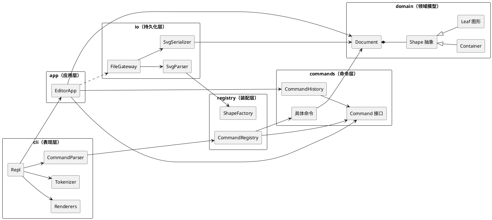

# Lab1 Phase 1 — CLI SVG 编辑器 · 设计文档

> 本文档是作业的正式交付物，包含**架构方案**、**过程记录**、**一致性自查**、**质量保证手段**四节。
> 文档随实现迭代，每次实质性变更记入 [§5 修订记录](#5-修订记录)。
>
> 当前版本：**v1（仓库搭建 / 架构方案初稿）** — 此时仅完成工程骨架与方案设计，
> 实现尚未开始，[§3 一致性自查](#3-一致性自查) 留待实现完成后如实填写。

---

## 目录

1. [架构方案](#1-架构方案)
2. [过程记录](#2-过程记录)
3. [一致性自查](#3-一致性自查)
4. [质量保证手段](#4-质量保证手段)
5. [修订记录](#5-修订记录)

---

## 1. 架构方案

### 1.1 模块划分

代码按**分层**组织，每层一个目录，层内"一类一文件"（文件名 = 类名）。

```text
svg-editor/
├── doc/                       # 设计文档（本文件）
├── src/
│   ├── main.ts                # 组合根：装配对象、启动 REPL
│   │
│   ├── domain/                # 【L0 领域模型】纯内存数据结构与几何语义，零 I/O
│   │   ├── Shape.ts           #   抽象基类：id、父指针、几何/属性访问器的抽象契约
│   │   ├── Container.ts       #   Composite：容器（对应 <g> 与画布根）
│   │   ├── Canvas.ts          #   画布根容器（宽高 + viewBox）
│   │   ├── Document.ts        #   当前文档：Canvas + id 索引 + 结构不变量
│   │   ├── IdIndex.ts         #   id → Shape 的唯一索引（唯一性/查找）
│   │   ├── ShapeError.ts      #   领域错误（no such shape / id already exists …）
│   │   └── leaf/              #   叶子图形：Rect / Circle / Ellipse / Line / TextShape
│   │
│   ├── commands/              # 【L1 命令层】Command 模式，一次编辑 = 一个对象
│   │   ├── Command.ts         #   接口：execute() / undo() / describe()
│   │   ├── CommandHistory.ts  #   undo / redo 双栈 + "IO 之后禁止 undo" 的闸门
│   │   ├── CommandContext.ts  #   命令可用的上下文（Document + 结果输出端口）
│   │   └── impl/              #   Create / Delete / Move / Scale / Set / Group /
│   │                          #   Ungroup / AddTo / Reorder(front,back)
│   │
│   ├── io/                    # 【L1 持久化层】SVG 文本 ↔ 领域模型
│   │   ├── FileGateway.ts     #   文件读写的唯一出口（错误 → cannot read/write file）
│   │   ├── SvgSerializer.ts   #   Document → SVG 文本
│   │   └── SvgParser.ts       #   SVG 文本 → Document（缺 id 自动补名 + 警告）
│   │
│   ├── registry/              # 【L2 装配层】仅有的两处"按名字分派"
│   │   ├── ShapeFactory.ts    #   图形类型名 → 构造函数（分派点 ①）
│   │   └── CommandRegistry.ts #   命令名 → 命令构造器 + 用法文本（分派点 ②）
│   │
│   ├── app/                   # 【L2 应用层】用例编排
│   │   └── EditorApp.ts       #   持有 Document / History，把结构化调用变成命令执行
│   │
│   └── cli/                   # 【L3 表现层】REPL、分词、渲染
│       ├── Repl.ts            #   读行循环、提示符、注释与空行
│       ├── Tokenizer.ts       #   处理双引号参数、`#` 注释
│       ├── CommandParser.ts   #   文本 → 结构化调用（token 序列 → 参数对象）
│       ├── ConsoleOutput.ts   #   输出端口的唯一实现
│       └── render/            #   TreeRenderer / ShowRenderer / HelpRenderer
│
└── tests/                     # 单元测试 + 场景回放测试
```

> 上面是**方案 v1 的目录设计**。实现期在层内新增了 9 个辅助类、删除了 1 个（`HelpText.ts`），
> 层归属与目录层级零变化。逐条偏差与原因见 [§3.1 一致性自查](#31-模块划分实际目录与方案是否一致)。

**各模块职责**

| 模块 | 职责 | 明确*不*做的事 |
|---|---|---|
| `domain` | 图形树的唯一真相：树结构、id 索引、几何属性、属性的读写与合法性（`set` 白名单） | 不解析文本、不读写文件、不打印、不知道 undo 的存在 |
| `commands` | 把"一次编辑"封装成可执行/可撤销对象；维护 undo/redo 栈 | 不解析命令行文本、不碰文件、不直接 `console.log` |
| `io` | SVG 文本与 `Document` 的双向转换；文件系统访问 | 不实现编辑语义、不做撤销、不决定 CLI 输出格式 |
| `registry` | 名字 → 实现的查表；命令用法文本的单一来源 | 不含业务规则（构造完命令就退出） |
| `app` | 用例编排：接收结构化调用 → 造命令 → 执行 → 组织结果 | 不做分词、不格式化输出 |
| `cli` | 行级 I/O、分词与参数解析、结果渲染（tree/show/help/错误行） | 不直接改图形树（一律经 `app` → `commands`） |

**组件图（PlantUML）**



箭头方向即编译期 `import` 方向，与 [§1.3 依赖方向规则](#13-依赖方向规则) 一一对应。

### 1.2 设计模式的选择

#### ① Command —— 撤销重做的骨架（作业要求必选）

**问题**：`undo` 必须精确还原上一次编辑，且 `group g1 r1 c1 t1` 这种多目标操作整体算**一个**撤销单元。

**落地方式**：

- 每个编辑类命令实现同一接口 `Command`：

  ```ts
  interface Command {
    execute(): CommandOutcome;   // 正向执行
    undo(): CommandOutcome;      // 精确回滚
    describe(): string;          // 成功摘要，如 `rect#r1 moved to (130,20)`
  }
  ```

- `CommandHistory` 只认这个接口，维护 `undoStack` / `redoStack`：
  `undo()` → 弹栈并调用 `command.undo()`；`redo()` → 弹 redo 栈并重新 `execute()`。
- "一条命令 = 一个单元"是**天然结论**：多目标操作写在同一个命令对象里，只有一对
  `execute/undo`，不会拆成多个栈元素。
- 撤销的反向信息由命令**自己**以 Memento 形式持有（删掉的子树快照 + 父节点 + 下标、
  属性旧值等），而不是对整个文档拍快照——避免 undo 栈随文档规模线性膨胀。
- `undo` 后若有新编辑，`redoStack` 清空（由 `CommandHistory` 单点保证）。

#### ② Composite —— 容器与叶子一视同仁

`Shape` 抽象基类统一 `id / parent / move / scale / setAttribute / delete` 语义；
`Container` 递归转发给子节点，叶子自己实现几何变换。因此
`move node2 0 100`（一个 `<g>`）与 `move c1 30 0`（一个 `<circle>`）在命令层毫无区别，
**命令实现里不出现任何 `if (isContainer)` 分支**。

#### ③ Factory + Registry —— 仅有的两处按名字分派

作业允许的"未模块化"只有两处，本方案把它们**各自压到一行查表**，并登记为待重构项：

- `ShapeFactory`：`type 名 → 构造函数`，供 `create` 与 `SvgParser` 共用；
- `CommandRegistry`：`命令名 → 命令构造器 + 用法文本`，供分发与 `help` 共用。

#### ④ 多态属性表（替代 `switch(tag)`）

`tree`、`show`、`save` 都需要"按图形类型做不同展示"，方案里**不写 `switch(tag)`**：

- 每个类型用 `geometryAttributes()` 声明自己的可写属性，`tree` / `show` / SVG 序列化
  都遍历同一份声明（`Shape.describeInline()` / `describeDetailLines()`）——
  `rect` 显示 `x= y= w= h=`，`circle` 显示 `cx= cy= r=`，由一个实现自然分派；
- `set` 的白名单同样来自这份声明（`settableAttributes()`），未知属性统一报
  `error: unknown attribute: <attr>`；
- 序列化由 `io/SvgSerializer` **数据驱动**：读 `shape.attributes()` 逐条输出，
  不做按类型分支。

> **实现期修订（v1.2）**：本节最初写的是"`Shape.toSvgElement()` 由子类实现"。
> 实现到 #18 时发现它与 §1.3「`domain` 不认识 XML」直接冲突——让子类产出 XML 元素，
> 等于把 XML 概念塞进领域层。改为上面的"属性表 + 数据驱动的序列化器"后，
> 领域层仍然零 XML 知识。差异已记入 §5 修订记录。

#### ⑤ Template Method —— `set` 的统一校验流程

`Shape.setAttribute()` 是模板方法：先在 `settableAttributes()` 声明的白名单里校验，
再交给子类的 `applyAttribute()` 做类型化赋值。校验与报错只有一份实现。

### 1.3 依赖方向规则

分层与允许的依赖：

| 层 | 模块 | 允许依赖 | 禁止依赖 |
|---|---|---|---|
| L0 | `domain` | 仅 TypeScript 标准库 | 任何其他内部模块；`node:fs` 等 I/O 模块 |
| L1 | `commands` | `domain` | `io`、`cli`、`app`、`registry` |
| L1 | `io` | `domain`、`registry` 的 `ShapeFactory` | `commands`、`cli`、`app` |
| L2 | `registry` | `domain`、`commands` | `io`、`cli`、`app` |
| L2 | `app` | `domain`、`commands`、`io`、`registry` | `cli` |
| L3 | `cli` | `app`、`domain`（只读类型与渲染）、`registry`（取用法文本） | `io` 的写操作 |
| L4 | `main.ts` | 所有层（唯一装配点） | — |

**附加规则**

1. **只允许"上层 → 下层"**，禁止同层横向依赖（`io` ⇸ `commands`，`commands` ⇸ `io`）。
2. **`domain` 不认识 XML，也不认识命令行**：它只提供数据结构与几何语义。
3. **`commands` 不碰文件系统**：`save` / `read` 属于文档类命令，由 `app` 编排 `io`，
   并且**不进入 undo 栈**（执行后置"IO 闸门"，使 `undo` 报
   `error: undo not allowed after io command`）。
4. **输出端口唯一**：`commands` / `app` 不直接写 `stdout`，只把结果返回给 `cli` 渲染；
   `io` 的错误转成领域错误向上抛，由 `cli` 统一加 `error:` 前缀。
5. **违反上述任一规则即记为待处理项**，在修订记录中登记并安排修复。

**理由**：把"会变的"（界面、持久化格式、撤销策略）挡在领域之外，使
`domain` 可以在完全没有 I/O 的情况下被单元测试覆盖；同时保证换一个前端（GUI / HTTP /
agent 通道）时，只新增一个 `cli` 层的 adapter，`app` 与 `domain` 零改动。

### 1.4 变化点假设

| # | 变化点 | 判断依据 | 为它留了什么 / 为什么不留 |
|---|---|---|---|
| 1 | **新增图形类型**（`polygon`/`path`，以及后续插件化的 `box`） | 作业 Phase 2–3 明确要求 `box` 由**插件**注册，`create box` 现在必须报 `unknown shape type` | **留了**：`Shape` 抽象 + `ShapeFactory` 注册表。Phase 2 只需让 `ShapeFactory` 变成可变注册表并引入 `ShapeProvider` 接口，`domain`/`commands` 不动。**本阶段不实现插件机制**，因为它尚无第二个消费者，过早抽象会锁死接口形状 |
| 2 | **输出通道变化**（CLI → GUI / HTTP / agent 工具调用） | 作业后续阶段会出现画布与"三种通道" | **留了**：`cli` 与 `app` 之间以**结构化调用对象**（`CommandInvocation`）为界，而不是裸字符串；换通道只需新写 adapter。**不留**的是多前端共存的抽象基类——当前只有 CLI 一个消费者 |
| 3 | **撤销策略变化**（命令逆操作 → 文档快照 / 持久化历史） | 快照法实现简单但内存随文档线性增长；命令逆操作精细但每个命令都要写 `undo` | **留了**：`CommandHistory` 只依赖 `Command` 接口，替换成快照式历史不影响命令实现；命令内部以 Memento 保存旧值，日后换成 `structuredClone` 全量快照只需改 `CommandContext` |
| 4 | **SVG 序列化格式变化**（`transform` 属性 vs 直接改写子坐标、`data-*` 标记、样式属性扩充） | `box` 的 round-trip 需要 `data-kind`，未来还可能引入 `transform` | **留了**：序列化/解析完全隔离在 `io`，`domain` 只存"语义属性"。**刻意不留**的是可插拔的序列化策略——一种格式一个实现实现即可，多态到策略只增加间接层 |
| 5 | **`scale` 的语义变化**（当前按作业要求"位置与尺寸同乘"，未来可能要"绕中心缩放"） | 作业定义了一次性语义，但图形编辑器的直觉是绕中心 | **留了**：缩放集中在 `Shape.scale(factor)` 一个方法，改为绕中心只改这一处 + 容器递归策略 |
| 6 | **寻址方式变化**（id 定位 → 结构路径 `/canvas/g1/rect[2]`） | 作业 §2 明确"结构路径本阶段不要求" | **刻意不留**：id 已是 SVG 规范内的合法寻址手段，且 `IdIndex` 是单点。留一层路径解析器会立刻产生"两套寻址并存"的一致性问题，得不偿失 |
| 7 | **性能：超大文档**（10k 节点） | 目前所有操作都是 O(n) 递归 | **刻意不留**：作业规模在百级节点，过早引入脏标记/增量索引会让代码复杂度上升而收益为零 |

### 1.5 已知待重构项

| # | 位置 | 现状 | 计划 |
|---|---|---|---|
| R1 | `registry/ShapeFactory.ts` | `type 名 → 构造函数` 的 `switch`/查表 | Phase 2 改为可注册的 `Map` + `ShapeProvider` 插槽 |
| R2 | `registry/CommandRegistry.ts` | `命令名 → 命令构造器` 的查表 | 同上；若命令数量增长，改为 `CommandParser` 负责语法、registry 只负责构造 |
| R3 | `cli/HelpText.ts` | 帮助文本暂时是静态常量 | 由 `CommandRegistry` 汇总各命令声明的用法生成（见 `HelpText.ts` 注释） |

---

## 2. 过程记录

记录关键、有代表性的讨论与迭代：AI 给了什么建议、发现了什么问题、如何确认并纠正。

> 本节是**经过整理的结论**，按阶段成文；未整理的原始流水（每天做了什么、推到哪个提交、还剩多少时间）
> 另记在 [`doc/PLAN.md`](PLAN.md) 的会话日志里。

### 2.1 阶段 0：仓库搭建

- **讨论点：先把仓库立起来，还是先写代码？**
  取舍：作业要求"提交历史须能体现开发过程，禁止 one-shot 大提交"。先把**工程骨架 +
  架构方案**单独提交，后续每个能力一次提交，历史本身就是开发过程的证据。
  因此本阶段的提交顺序被刻意设计为
  `仓库配置 → 工具链 → 架构方案文档 → REPL 骨架`，且第一条提交里没有任何业务逻辑。
- **讨论点：构建产物要不要入库？**
  决定：不入库（`.gitignore` 忽略 `dist/`、`node_modules/`），工程用 `npm run cli`
  一条命令完成"编译 + 启动"，保证 clone 下来即可复现。
- **待续**：实现阶段的讨论记录（发现的问题、被否掉的方案）见下文。

### 2.2 阶段 1：领域模型与命令层（10/21）

本节记录的都是**真的发生过**的问题：AI 先给方案 → 写下去撞墙 → 确认原因 → 改。

#### ① 撤销用属性快照，而不是"反向操作"

最初的想法很自然：`move` 的逆是 `move(-dx, -dy)`，`scale(f)` 的逆是 `scale(1/f)`。
动手写测试时立刻遇到两个反例：

- `0.1 + 0.2 - 0.2 !== 0.1`（浮点加减不保值）；
- `scale(3)` 之后 `scale(1/3)` 回不到原坐标。

改成 `ShapeSnapshot`：记录受影响子树每个属性的**字符串原值**，恢复时逐字写回。
用例 `scale(3) 撤销后回到精确原值，而不是 99.99999` 钉住了这条。

同时**否决了"整文档快照"**这个更省事的选择：撤销栈每层存整棵树，深度一上去内存就爆。
因为 `move` / `scale` 不改结构，只记受影响子树的属性就已经完备。

#### ② `Document.attach` 在"移动归属"路径上误报 id 冲突

`group` / `addto` 需要把**已登记**的图形换一个父容器。第一版 `attach` 无条件调用
`registerTree`，于是 `doc.attach(markers, c1)` 直接抛 `id already exists: c1`。

修正为区分两种情况：首次挂载才登记子树，"移动归属"只改父指针。
这个问题是跑冒烟脚本撞出来的，不是读代码看出来的——说明只靠类型检查和单元测试还不够，
得有端到端跑一遍的习惯。

#### ③ 测试推翻了实现假设，也推翻了我的测试假设

我原以为 `set c1 r abc` 应该在**构造命令时**就报错，于是断言写成了构造期抛错。
实际是在 `execute()` 期抛的。第一反应是"实现错了"，核对后确认这是对的：

- 属性值是否合法，只有 `AttributeSpec.write` 有资格判断，命令层重复实现解析会立刻出现两份真相；
- 安全性由 `CommandHistory.run` 的结构保证——`execute()` 抛错就不入栈、也不会有半成品状态。

于是改的是**测试**而不是实现，断言变成「`run` 抛错 + 撤销栈深度仍为 0 + 状态未变」。
这比原来的断言更准确地验证了那条不变量。

#### ④ 错误语义的自我纠正

`Container.insertChild` 拒绝自环时抛的是 `invalid id: cannot add g#g1 into itself`，
模板套错了（`invalid id` 是给非法 id 用的）。新增 `ShapeError.cannotInsertIntoSelf`，
消息改为 `cannot insert a container into itself: g1`。

### 2.3 阶段 2：持久化与 CLI（10/22）

#### ① 方案与依赖规则打架：`toSvgElement`

原架构方案 §1.2 ④ 写的是"`Shape.toSvgElement()` 由子类实现，序列化不集中在一处大 `switch`"。
写到 io 层时发现它和 §1.3 的「`domain` 不认识 XML」**直接冲突**——让领域对象产出 XML 元素，
等于把 XML 概念塞进领域层。三个可选方案：

| 方案 | 问题 |
|---|---|
| A. 保持原方案，在 `domain` 里定义 `SvgElement` 模型 | `domain` 依赖 XML 概念，违反 §1.3 |
| B. 序列化器里写 `switch (shape.kind)` | 正好踩中作业禁止的"到处 `switch(tag)`" |
| C. 各类型声明属性表，序列化器数据驱动遍历 | 无分支，`domain` 仍零 XML 知识 |

选 C。改动不大，但它**同时改了三处**：§1.2 正文、§5 修订记录 v1.2、`doc/PLAN.md §5.1` 的待办状态。
这正是"一致性自查"要的东西：方案偏离就留痕，而不是事后当没发生过。

#### ② `tree` 的属性列宽：作业给的两个示例互相矛盾

用**同一套算法**推不出两个示例：§5.1 例 1 的属性列在第 19 列，§6.1 的例子在第 29 列。

实现取"**列宽 = 最宽（前缀 + id）+ 2，且至少 1 个空格**"。实测结果：

- §5.1 例 1 —— **逐字一致**；
- §6 transcript 里 `read other.svg` 之后的树 —— **逐字一致**（也是 19 列）；
- §6.1 流程图 —— 内容完全一致，但整体宽 3 列。

三个示例里两个逐字复现，第三个是格式差异而非语义差异，故按格式差异处理并把取舍写在这里。
（另外 §6 的树里 `ellipse#e1 … y=2` 是笔误：SVG 椭圆没有 `y`，实际属性是 `cy`，
本实现输出 `cy=2`。）

#### ③ 待重构项 R3 是"顺手"消除的

`help` 最初是一份静态常量 `src/cli/HelpText.ts`，加一条命令要改两处（实现 + 帮助文本），
在方案里被登记为待重构项 R3。做成 `CommandRegistry` 后，命令的 `usage` / `summary` 就写在
命令自己的声明里，`help` 直接汇总——**加一条命令只改一个地方**。
`tests/cli/CommandRegistry.test.ts` 里有一个用例专门验证这点："注册一条新命令后 help 自动包含它"。

#### ④ 我算错了命令条数

计划里一直写"命令覆盖 23/23"。真正逐行数作业 §3 的命令总表：共 17 行，
其中 `front / back` 与 `undo / redo` 各占一行但含两条命令，合计 **19 条**。
已在总览、Day 3 验收标准、`PLAN.md §5.1` 三处修正。教训：验收标准要拿总表逐行数，不能凭印象估。

#### ⑤ 一次与代码无关的阻塞

10/22 下午本机代理未运行，直连 `github.com:443` 能建立 TCP 但 TLS 被重置
（`Recv failure: Connection was reset`，换成 Schannel 后端也无效），导致 5 个提交滞留在本地。
处理方式是把阻塞**写进 `PLAN.md §5.2`**（含现象、影响、恢复条件），而不是让看板显示"一切正常"；
代理恢复后一次 `git push` 解决，再把该节改为"已解除"。

### 2.4 Day 2 端到端验收结果

| # | 验收项 | 结果 | 证据与说明 |
|---|---|---|---|
| 1 | 作业 §6 会话回放与 transcript 逐行一致 | ✅ 通过 | 场景脚本 `doc/scenarios/basic-session.txt`，回放输出见 `basic-session.golden.txt`（69 行）。`canvas 800x600 created`、`saved to demo.svg (5 elements)`、`error: undo not allowed after io command`、`warning: assigned id rect1 to unnamed <rect>`、`read other.svg (7 elements)` 全部逐字一致；仅 §6 原文的 `ellipse … y=2` 按 SVG 规范输出为 `cy=2`（原文笔误） |
| 2 | 作业 §6.1 两节点流程图 | ✅ 通过 | `doc/scenarios/flowchart-session.txt`；8 个元素、层级与作业一致；`move node2 0 100` 后 `g#node2 moved by (0,100)`、`undo` 后 `moved back by (0,-100)`；树的内容一致，属性列宽差 3 列（格式差异，见 §2.3 ②） |
| 3 | `save` 出的 SVG 在浏览器正确渲染 | ✅ 通过 | 用无头 Edge 打开 `demo.svg` 与 `flowchart.svg` 截图：`doc/images/demo-render.png`、`doc/images/flowchart-render.png`。可见白底、红色圆（已移动到 130,100）、蓝色方块、文字，以及流程图的连线与中文标题 |
| 4 | 文档类命令后 `undo` 被拒 | ✅ 通过 | `save demo.svg` 之后 `undo` 输出 `error: undo not allowed after io command`；`init` / `read` 走 `CommandHistory.reset()`（连栈一起作废），`save` / `canvas` 走 `markIoBoundary()`（栈保留、只上闸门） |

### 2.5 阶段 3：质量保证与收尾（10/23）

#### ① 依赖检查第一次运行就把我判了：12 处违规

Day 3 的第一件事是给 §1.3 的规则写一个可执行检查。写完后第一次运行：

```text
依赖方向检查失败：12 处违规（app:1 cli:12 commands:15 domain:13 io:5 entry:1 registry:2）
```

全部是 `cli → commands`。原因很朴素：Handler 为了 `new XxxCommand(...)` 直接 import 了
9 个命令类，`Tokenizer` 为了抛语法错误引用了 `CommandError`。

这里的判断很关键：**是我实现时偷懒了，还是规则定错了？**

- 方案 §1.1 写的是"app：接收结构化调用 → **造命令** → 执行"；
- 方案 §1.3 的 cli 允许依赖表里没有 `commands`。

两条都指向同一结论：**代码错了，规则没错**。所以选择改代码而不是改规则。

修复用了三个候选方案里最"疼"的一个：

| 方案 | 代价 | 取舍 |
|---|---|---|
| A. 放宽 §1.3，允许 cli → commands | 改两行文档 | ✗ 等于承认"分层只是写着好看" |
| B. 让 registry 帮 cli 造命令 | 注册表要认识所有命令参数 | ✗ 把分派点变成业务层 |
| C. 把命令构造下沉到 `EditorApp` | 应用层多 9 个方法，cli 层要重写 | ✓ 与 §1.1 的原意一致 |

选 C。改完 `check-layers` 退出码 0。**这件事本身就是 §1.3 那句"违反规则的依赖即为待处理项"的意义**：
如果没有脚本，这 12 处会一直躺在那里，而我在写一致性自查时会理直气壮地写"经检查无违反"。

#### ② 又一个测试假设被推翻：XML 转义规则

写 io 测试时我断言"文本里的 `"` 也会转义成 `&quot;`"，测试红了。查下来是**测试错了**：

| 位置 | `<` | `&` | `"` |
|---|---|---|---|
| 元素**内容** | 必须转义 | 必须转义 | **无需转义**（合法字符） |
| 属性**值** | 必须转义 | 必须转义 | 必须转义 |

改成两个用例分别钉住两种情况。这和 §2.2 ③ 是同一类经验：**测试先去验证"我以为的规则"，
发现规则本身理解错了，改的应该是测试而不是实现**。但前提是能分清这两种情况——
判据是去查规范/实现，而不是"哪个改起来更省事"。

#### ③ 有一条错误我根本无法覆盖

作业 §4.2 的 `cannot ungroup composite shape` 是给插件阶段的 `box` 用的。本阶段没有插件，
这条错误永远不会被触发。

处理方式：**不写假装通过的用例**。改成验证"普通非顶层 `g` 必须能解散"，
并在 `§4.3` 明确标注 `⚠️ 本阶段 N/A`，覆盖率写成 **11 / 11 可触发项**而不是含糊的 12/12。

把"没实现"混进"覆盖率 100%"是最容易糊弄也最没价值的做法——评审只要问一句
"这条错误在哪触发"就穿帮了。

#### ④ 计划外多了一个提交

原计划 32 个提交，实际 33 个：`#26a` 是重构，不在计划里。

处理方式：在看板 `§2` 里加一行标注「**追加**」，写明原因（检查器抓到违规必须改），
而不是悄悄改编号或压进别的提交。计划可以变，但变化要留痕——这是 `doc/PLAN.md §5.1` 的用意。

---

## 3. 一致性自查

> 本节对照方案**如实回答**，不是复述方案。检查方法尽量做成可重跑的命令，结论附实测输出。

### 3.1 模块划分：实际目录与方案是否一致？

**检查方法**：`git ls-files src` 取实际清单，与 §1.1 的目录树逐条对照。

**实际规模**：50 个源文件 —— `domain` 13、`commands` 15、`io` 5、`registry` 2、`app` 1、`cli` 13、入口 1。

**一致的部分**（§1.1 列出的路径全部存在，职责未变）：

```text
src/main.ts
src/domain/{Shape, Container, Canvas, Document, IdIndex, ShapeError}.ts   + leaf/×5
src/commands/{Command, CommandContext, CommandHistory}.ts                 + impl/×9
src/io/{FileGateway, SvgParser, SvgSerializer}.ts
src/registry/{ShapeFactory, CommandRegistry}.ts
src/app/EditorApp.ts
src/cli/{Repl, Tokenizer, CommandParser, ConsoleOutput}.ts               + render/×2
```

**偏差 10 项**（全部已登记到 §5 修订记录 v1.4）：

| 文件 | 类型 | 引入于 | 方案里为什么没有 |
|---|---|---|---|
| `domain/Numbers.ts` | 新增 | #6 | 数值解析与格式化需要被 `set`、`tree`、序列化共用；写方案时没意识到会有三处共用同一套格式 |
| `domain/EditorError.ts` | 新增 | #24 | 统一错误基类，是"两个错误子类各管一段、表现层要分别 catch"这个问题的收口 |
| `commands/DocumentCommand.ts` | 新增 | #12 | 命令基类，省掉 9 条命令重复写 `context` 字段与构造函数 |
| `commands/CommandError.ts` | 新增 | #11 | 与 `ShapeError` 分工：一个说"图形树不成立"，一个说"这个操作现在不能做" |
| `commands/ShapeSnapshot.ts` | 新增 | #13 | 方案写的是"命令自己持有 Memento"；实现时抽成独立类，因为 move 与 scale 共用同一套快照逻辑 |
| `io/xml/{XmlElement, XmlParser}.ts` | 新增 | #19 | 自研 XML 子集解析器。方案假设"解析 SVG"是件小事，实际要处理声明、注释、自闭合、属性和实体 |
| `cli/CliError.ts` | 新增 | #26a | 语法类错误（引号、参数个数）归表现层，是被 §3.2 的检查逼出来的 |
| `cli/handlers/×5` | 新增 | #22 | 命令表的具体条目。方案只写到 `CommandRegistry` 这一层，没细化到"每条命令一个声明放哪" |
| `cli/DefaultCommandRegistry.ts` | 新增 | #22 | 唯一装配点（全项目仅此处知道"一共有哪些命令"） |
| `cli/HelpText.ts` | **删除** | #22 | 待重构项 R3：静态帮助常量被注册表生成的文本取代 |

**结论**：**层归属零变化**——偏差全部是"层内新增辅助类"，没有任何文件跨层搬家，也没有新的目录层级。
唯一的删除是方案自己列为待重构项 R3 的 `HelpText.ts`，属于按计划还债。

### 3.2 依赖方向：方案里的规则有没有被违反？

**检查方法**：不靠抽样肉眼看，做成可执行检查。

```text
node tools/check-layers.mjs
```

它扫描 `src/**/*.ts` 的全部静态 `import` / `export … from`，按 §1.3 的矩阵逐条断言，
额外检查 `domain` 不得出现 `node:*`。违规即退出码 1。

#### 第一次运行：失败，12 处违规

```text
依赖方向检查失败：12 处违规（app:1  cli:12  commands:15  domain:13  io:5  entry:1  registry:2）
  src/cli/handlers/EditCommandHandlers.ts:3   cli 不允许依赖 commands
      ../../commands/impl/AddToCommand.js
  src/cli/handlers/EditCommandHandlers.ts:4   cli 不允许依赖 commands
      ../../commands/impl/CreateShapeCommand.js
  …（另 8 条同类：10 个命令类 + CommandError）
  src/cli/Tokenizer.ts:1                      cli 不允许依赖 commands
      ../commands/CommandError.js
```

完整清单存档在 [`doc/quality/check-layers-before.txt`](quality/check-layers-before.txt)。

**根因**：Handler 为了 `new XxxCommand(...)` 直接 import 了 9 个命令类；`Tokenizer` 为了抛
`unclosed double quote` 引用了 `CommandError`。而 §1.1 明确写着"app 负责造命令"，
§1.3 的 cli 允许依赖表里也没有 `commands`——**是实现的错，不是规则的错**。

**修复**（追加提交 `#26a`，详见 §2.3）：

- 命令构造下沉到 `EditorApp` 的 9 个编辑方法，表现层只表达意图；
- 语法类错误改由新增的 `cli/CliError` 承担（它的判据完全来自命令行文本，归表现层更准确）。

#### 修复后的输出

```text
依赖方向检查通过（app:1  cli:13  commands:15  domain:13  io:5  entry:1  registry:2）
```

退出码 0，已纳入 `npm run verify` 与每个提交的门禁。

#### 抽样核对（脚本之外的旁证）

`domain` 层 27 条 `import` 全部指向 domain 内部（`./` 或 `../`），`node:` 出现 **0 次**：

```text
Canvas.ts: ./Container.js          Document.ts: ./IdIndex.js        Rect.ts: ../Shape.js
Circle.ts: ../Numbers.js           IdIndex.ts:  ./Shape.js          Shape.ts: ./Numbers.js
Container.ts: ./Shape.js           Numbers.ts:  ./ShapeError.js     …
（共 27 条，无一条跨层）
```

**结论**：**规则最终没有被违反**，但违规真实发生过 12 次——是这条可执行检查把它们拦住的，
不是自觉。这也解释了 §1.3 那句"违反规则的依赖即为待处理项"为什么要配一个脚本。

---

## 4. 质量保证手段

### 4.1 门禁与实测结果

每个提交前都跑同一组命令，四条全绿才允许提交：

```text
node_modules/.bin/tsc -p tsconfig.json          # 编译
node_modules/.bin/tsc -p tsconfig.test.json     # 类型检查（含 tests/）
node_modules/.bin/vitest run                    # 单元 + 集成 + 场景测试
node tools/check-layers.mjs                     # 架构约束
```

（等价的单条命令：`npm run verify`。）

定稿时的实测值：

| 项 | 结果 |
|---|---|
| 类型检查 | 0 错误（`strict` + `noUncheckedIndexedAccess` + `noImplicitOverride` + `verbatimModuleSyntax`） |
| 测试文件 | 13 个 |
| 测试用例 | **175 个，全部通过** |
| 架构约束 | `check-layers` 退出码 0（违规 0 处） |
| 场景对拍 | 作业 §6 会话 69 行输出与 golden 文件逐字相等 |

用例分布：

| 层 / 主题 | 文件 | 用例数 |
|---|---|---|
| 领域模型 | `tests/domain/{transform,attributes,document}.test.ts` | 12 + 21 + 16 = 49 |
| 命令与撤销 | `tests/commands/{CommandHistory,editCommands,errorPaths}.test.ts` | 11 + 31 + 18 = 60 |
| CLI | `tests/cli/{Tokenizer,CommandRegistry,render,Repl}.test.ts` | 13 + 8 + 8 + 7 = 36 |
| 应用层 | `tests/app/EditorApp.test.ts` | 8 |
| 持久化 | `tests/io/roundtrip.test.ts` | 17 |
| 场景回放 | `tests/scenarios/replay.test.ts` | 5 |

下面几节说明这些手段各自要挡住什么。

| 手段 | 具体做法 | 期望证据 |
|---|---|---|
| 类型检查 | `tsc --noEmit`（`strict`、`noUncheckedIndexedAccess`、`noImplicitOverride`） | CI 式脚本 `npm run typecheck` 零错误 |
| 领域单元测试 | `domain` 无 I/O，可对 Composite 语义（move/scale 递归）、id 唯一性、set 白名单直接断言 | `tests/domain/*` |
| 命令测试 | 每个命令的 `execute` → `undo` 后**结构深比较**回到执行前状态 | `tests/commands/editCommands.test.ts` |
| 场景回放（对拍） | 把作业 §6 的 transcript 存成脚本，回放后逐行比对 golden 文件 | `tests/scenarios/replay.test.ts` |
| Round-trip | `save` → `read` → 结构深比较，并断言序列化幂等 | `tests/io/roundtrip.test.ts` |
| 错误路径 | §4.2 每一行错误信息都有一个用例，断言"失败不改状态" | `tests/commands/errorPaths.test.ts` |
| 架构约束 | 依赖方向矩阵做成可执行检查，违规即退出码 1 | `tools/check-layers.mjs` |
| 手工验收 | 用浏览器（无头 Edge）打开 `save` 出的 SVG 截图目视核对 | `doc/images/*.png` |

### 4.2 命令覆盖矩阵（作业 §3 命令总表，共 19 条）

判定口径：**正常路径**要有成功用例，**错误路径**要有失败用例且断言状态不变，
**undo 还原**要验证执行后撤销能回到原状（文档类与显示类命令本就不进撤销栈，标 `—` 并注明原因）。

| # | 命令 | 正常路径 | 错误路径 | undo 还原 |
|---|---|---|---|---|
| 1 | `init [w] [h]` | `tests/app/EditorApp.test.ts`、`tests/scenarios/replay.test.ts` | `errorPaths` 第 11 条（未 init 时报 no document） | — 文档类，换文档后历史作废 |
| 2 | `read <file.svg>` | `tests/app/EditorApp.test.ts`、`tests/io/roundtrip.test.ts` | `errorPaths` 第 10a 条（文件不存在） | — 文档类 |
| 3 | `save [file.svg]` | `tests/app/EditorApp.test.ts`、`tests/scenarios/replay.test.ts` | `errorPaths` 第 10b 条（不可写） | — 文档类，只上闸门 |
| 4 | `canvas [w] [h]` | `tests/app/EditorApp.test.ts`（显示尺寸 / 改尺寸 / 坐标不随画布变化） | `errorPaths` 第 11 条 + 参数个数 | — 文档类，只上闸门 |
| 5 | `create <type> <id> …` | `editCommands` › create | `errorPaths` 第 1 / 3 / 4 / 5 条 | ✅ 深比较 |
| 6 | `delete <id>` | `editCommands` › delete | `errorPaths` 第 2 条 | ✅ 深比较（含整棵子树） |
| 7 | `move <id> <dx> <dy>` | `editCommands` › move | `errorPaths` 第 2 条 + 参数个数 | ✅ 深比较（含小数） |
| 8 | `scale <id> <factor>` | `editCommands` › scale | `errorPaths` 第 9 条 | ✅ 深比较（`scale(3)` 精确回退） |
| 9 | `set <id> <attr> <value>` | `editCommands` › set | `errorPaths` › 白名单外 / 非法值 | ✅ 深比较（含"原本没有的属性去掉了"） |
| 10 | `group <newGid> <id1> …` | `editCommands` › group | `errorPaths` 第 7 条 + id 冲突 | ✅ 一次撤销还原全部 |
| 11 | `ungroup <gid>` | `editCommands` › ungroup | `errorPaths` 第 6 / 8 条 | ✅ 深比较 |
| 12 | `addto <gid> <id>` | `editCommands` › addto | `errorPaths` 第 7 条（成环） | ✅ 深比较（回原父容器原位） |
| 13 | `front <id>` | `editCommands` › front | `errorPaths` 第 2 条 | ✅ 回到原下标 |
| 14 | `back <id>` | `editCommands` › back | `errorPaths` 第 2 条 | ✅ 回到原下标 |
| 15 | `tree [id]` | `tests/cli/render.test.ts`、`tests/scenarios/replay.test.ts` | `render` 不存在的 id | — 显示类 |
| 16 | `show <id>` | `tests/cli/render.test.ts` | 不存在的 id | — 显示类 |
| 17 | `help` | `tests/cli/CommandRegistry.test.ts` | — | — 显示类 |
| 18 | `undo` | `editCommands` › undo/redo 交互、`tests/commands/CommandHistory.test.ts` | `errorPaths`（空栈、IO 闸门） | — 它本身就是撤销 |
| 19 | `redo` | 同上 | `errorPaths`（空栈、IO 闸门） | — |

**覆盖率：19 / 19。** 唯一没有对应错误用例的是 `help`——它没有可失败的输入路径。

### 4.3 错误信息覆盖（作业 §4.2，共 12 行）

| # | 场景 | 用例 | 状态 |
|---|---|---|---|
| 1 | id 已存在 | `errorPaths` › 1 | ✅ |
| 2 | id 不存在 | `errorPaths` › 2 | ✅ |
| 3 | `in` 目标不存在 | `errorPaths` › 3 | ✅ |
| 4 | `in` 目标不是容器 | `errorPaths` › 4 | ✅ |
| 5 | 未注册的图形类型 | `errorPaths` › 5 | ✅ |
| 6 | ungroup 复合图形 | `errorPaths` › 6 | ⚠️ 本阶段 N/A（`box` 属插件阶段，该错误无法触发）；用例改为验证"普通非顶层 `g` 必须能解散" |
| 7 | group 含容器与其子孙 | `errorPaths` › 7 | ✅ |
| 8 | ungroup 根级容器 | `errorPaths` › 8 | ✅ |
| 9 | scale 非正数 | `errorPaths` › 9 | ✅ |
| 10 | 文件不存在 / 不可写 | `errorPaths` › 10a / 10b | ✅ |
| 11 | 未 read/init | `errorPaths` › 11 | ✅ |
| 12 | `undo not allowed after io command`（§4.3） | `errorPaths` › 闸门用例 | ✅ |

**覆盖率：11 / 11 可触发项**（第 6 条按阶段边界不计）。

每条错误用例都同时断言两件事：**报出规定文案** + **整棵树深比较不变、撤销栈深度不变**。
只断言文案是不够的——实现里"先改一半再抛错"也能让文案通过。

---

## 5. 修订记录

| 版本 | 提交主题 | 变更内容 |
|---|---|---|
| v1 | `docs(architecture): 架构方案第一版` | 建立模块划分、依赖规则、变化点假设；一致性自查与质量保证留待实现后补全 |
| v1.1 | `docs(plan): 三天开发计划与进度看板` | 新增 [`doc/PLAN.md`](PLAN.md)：把开发窗口压成 3 天（10/21–10/23，10/24–10/25 缓冲），逐提交列进度、每日验收标准与维护约定；本节（§2）指向该文档的原始流水 |
| v1.2 | `feat(io): ShapeFactory 与 SVG 序列化` | **§1.2 ④ 修订**：原方案用 `Shape.toSvgElement()` 由子类实现序列化，与 §1.3「`domain` 不认识 XML」冲突；改为"各类型声明属性表 + `io/SvgSerializer` 数据驱动遍历"，领域层保持零 XML 知识。实现偏离方案的这一处按 §3.1 要求登记于此 |
| v1.3 | `docs(process): 追加 Day 1–2 过程记录` | **§2 成文**：补 2.2 / 2.3 / 2.4 三节，记录领域层与 io 层的真实返工（撤销快照、attach 误报、set 校验时机、`toSvgElement` 冲突、tree 列宽矛盾、命令条数算错）以及 Day 2 四条端到端验收结果；新增 `doc/scenarios/`（可回放场景 + golden 输出）与 `doc/images/`（渲染截图） |
